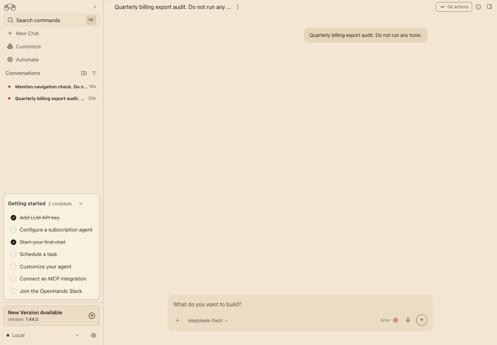
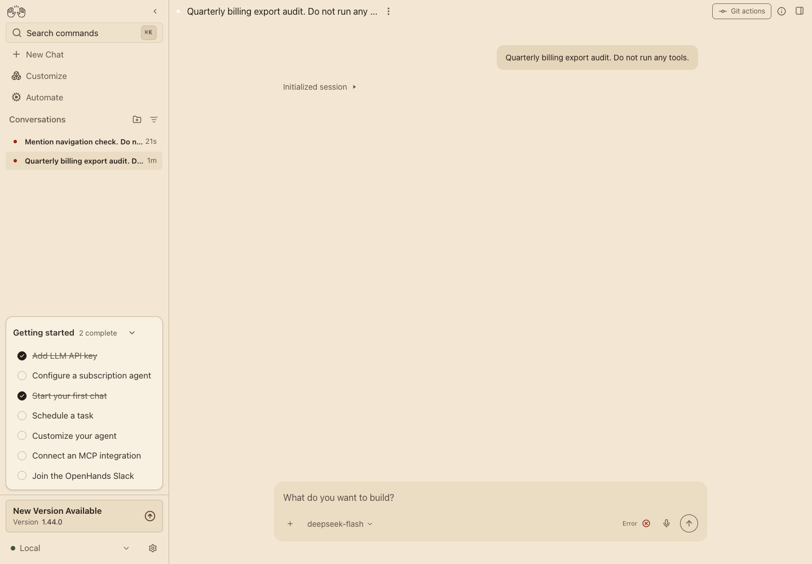

# Conversation mention route evidence — 2026-11-23

AI-generated verification notes by Amp on behalf of Engel Nyst.

- PR: https://github.com/OpenHands/OpenHands/pull/19940
- Issue: https://github.com/OpenHands/OpenHands/issues/19939
- Baseline: `0f4cb6af95915fee776913c4aa8694e7c4b76033` (PR parent).
- Fix: `0f7b1af882e616a68466fdcd2b94d71c09478944`, also mirrored unchanged to
  `enyst/OpenHands:claude/fix-mention-dashed-route`.
- Real isolated Canvas stacks, Agent Server 1.63.1, desktop 1440 × 1000.
- Both screenshots were captured in **Paper** after selecting it in Application
  settings. Readbacks independently confirm `theme: "paper"`.

## Reproduction

Use each source revision's checked-in `control-openhands` CLI:

1. `launch --new`, `doctor`, `onboard --skip`.
2. Open `/settings/app`, click `testid=color-theme-input`, select Paper.
3. Set up `llm preset deepseek` with an intentionally invalid placeholder key and
   `--no-validate`. Enable mentions using
   `api PATCH /api/settings/experimental/conversation_mentions --write --data '{"enabled":true}'`.
4. Start A with `Quarterly billing export audit. Do not run any tools.` and B with
   `Mention navigation check. Do not run any tools.` via `conversation start`.
5. Send B `See [Quarterly billing export audit](conversation:<A's 32 hex digits>) for context. Do not run any tools.`
   using `conversation send`.
6. Read `browser attr 'testid=conversation-mention' href`, click that rendered
   link, and inspect the URL, the target sidebar row's `aria-current="page"`,
   and the presence of `Initialized session`.
7. Go back to B and click the same rendered mention a second time.

No responses, routes, or conversation events were mocked. The composer shows
**Error** because the placeholder key cannot authenticate; that is expected and
is not the navigation bug. No successful model response or tool execution is
claimed.

## Observed results

| Source | Clicks | Mention destination | Target row current | Initialized session |
| --- | --- | --- | --- | --- |
| Baseline | 2/2 | `/conversations/37070fc4efc846608ed6baee9a76d7e3` | No | Absent |
| PR head | 2/2 | `/conversations/e49a18ef-7734-4e7a-bad5-4b303e732c5d` | Yes | Present |

The unedited screenshots show the first click's resulting state. JSON readbacks
show the second click's resulting state; `currentConversationRows` counts only
the target conversation row, not other navigation links.

## CI diagnosis and additional verification

The latest failing upstream run was PR Description Check
https://github.com/OpenHands/OpenHands/actions/runs/45223280520.
Its only validator error was missing screenshot/video evidence. The body used
ordinary links with stray backticks instead of inline image syntax. The same
error reproduced locally against the fetched body. No validator was changed.

Existing upstream CI run https://github.com/OpenHands/OpenHands/actions/runs/44908840305
passed Ubuntu lint, tests, app/library builds, package verification, and the
Windows app build. Docker builds also passed. No SDK API or infrastructure
failure was present in the current check rollup. The fork mirror push starts no
CI under the fork's branch filters; no fork PR was opened.

Fresh local verification of the exact mirrored PR head: production build passed;
`npx vitest run __tests__/components/features/markdown __tests__/hooks/chat/use-conversation-mention-picker.test.ts`
passed all 103 tests in 9 files. Both live stack doctor checks passed.
