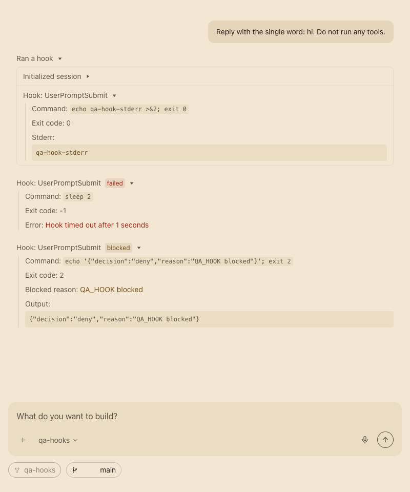
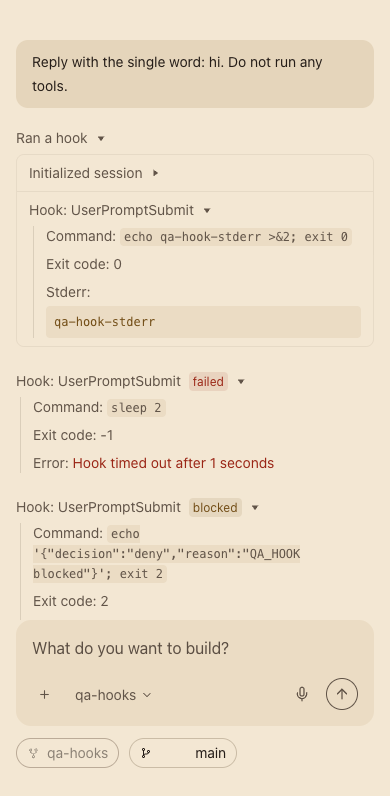
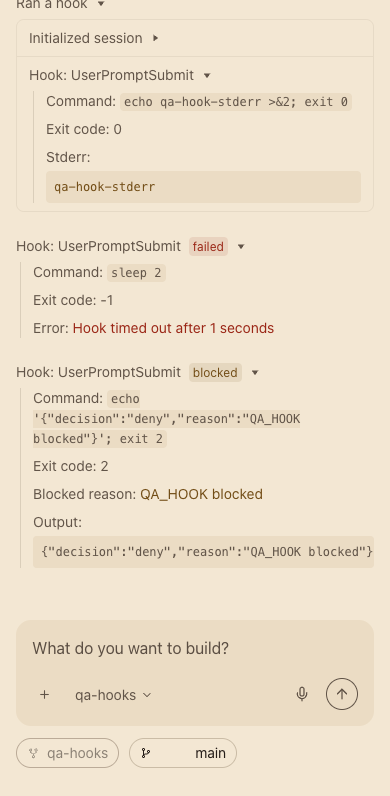

# Hook label contrast: current-head Paper evidence

AI-generated verification by Amp on Engel Nyst's behalf, 2026-11-23.

- PR: https://github.com/OpenHands/OpenHands/pull/20005
- Exact source: `8ce32d01744f02debe75a6cfbf3c041d7cb10437`, including the latest merge from main.
- Real isolated Canvas launched from a separate worktree using the read-only `control-openhands` driver; Agent Server 1.63.1, automation 1.35.0. Existing checkouts and running stacks were left alone.
- Theme: **Paper**, selected through Settings > Application before taking any screenshot. Desktop 1440 × 1000; phone 390 × 844.

## Reproduction and observations

Launch with `control-openhands launch --new`, run `doctor`, skip onboarding, select Paper, and create the `qa-hooks` Git fixture. Install the issue's three real `user_prompt_submit` command hooks in that fixture: stderr with exit 0; `sleep 2` with timeout 1; and a JSON deny decision with exit 2. Start a conversation in that workspace, expand the event group and all three hook rows. No requests or events were mocked. The deny hook blocks before model execution, so a dummy profile pointed at an unreachable loopback endpoint suffices; no model completion or paid credential is needed.

All ten visible detail labels compute to `rgb(97, 84, 72)` on Paper's `rgb(243, 231, 211)` (5.99:1). The real outcomes are exit 0 with stderr, exit -1 with the timeout error, and exit 2 with the blocked reason and JSON output. `Context:` is not produced by this fixture. Paper already passed before this PR, so these images demonstrate the current live rendering and light-theme preservation, not the original dark-theme contrast failure. The earlier before/after dark-theme evidence remains pinned in the PR description.

Phone checks found no horizontal page overflow; the final phone capture scrolls to show the entire blocked reason and output above the composer. Browser diagnostics report zero page errors and zero app errors. Every published image was inspected for layout and secrets.

## Local validation

- The unchanged PR description fails the production description validator with exactly one error: no screenshot or video is recognized. Its Markdown links contain stray backticks and lack image syntax.
- The three targeted hook/event grouping suites pass: 89 tests.
- `npx tsc --noEmit` passes.
- The production build succeeds as part of isolated launch.
- No product source, tests, or CI checks were changed to repair the description failure.

## Images

