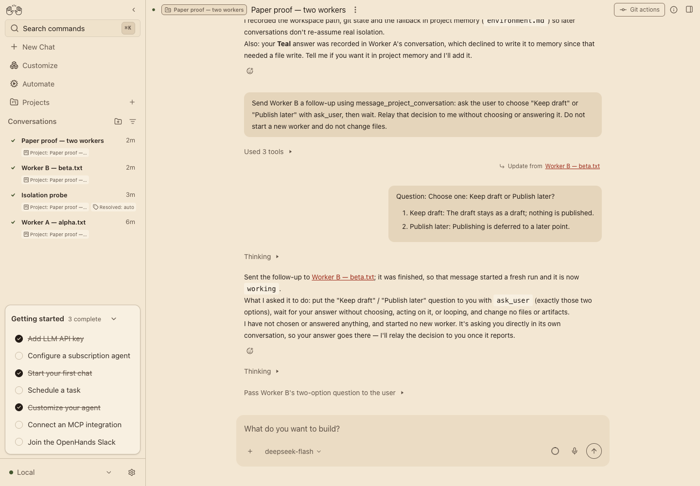
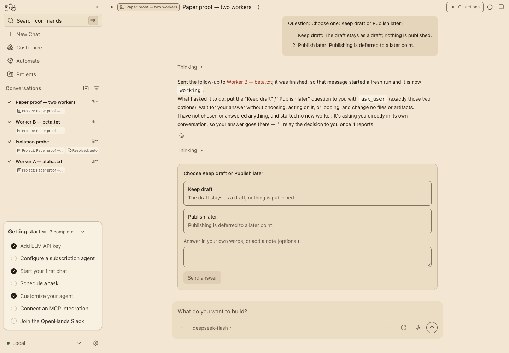
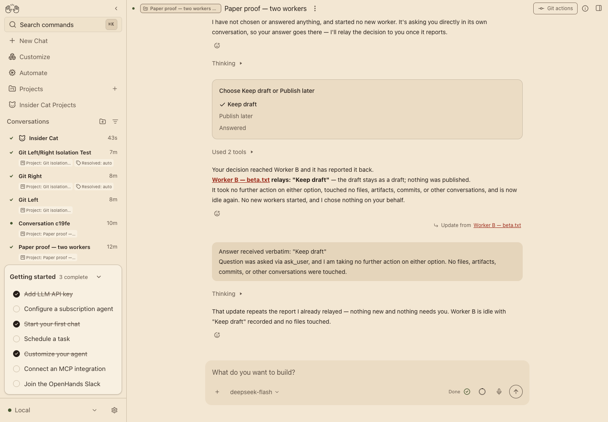
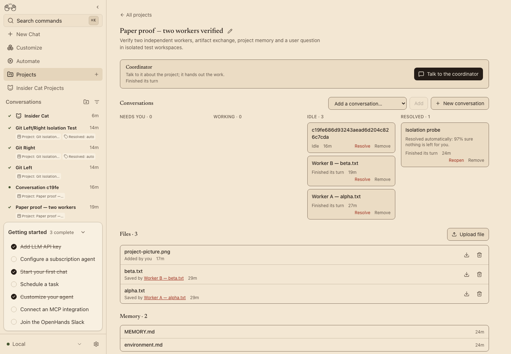
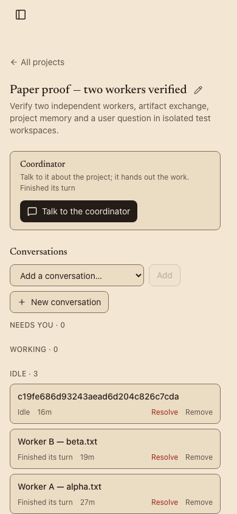
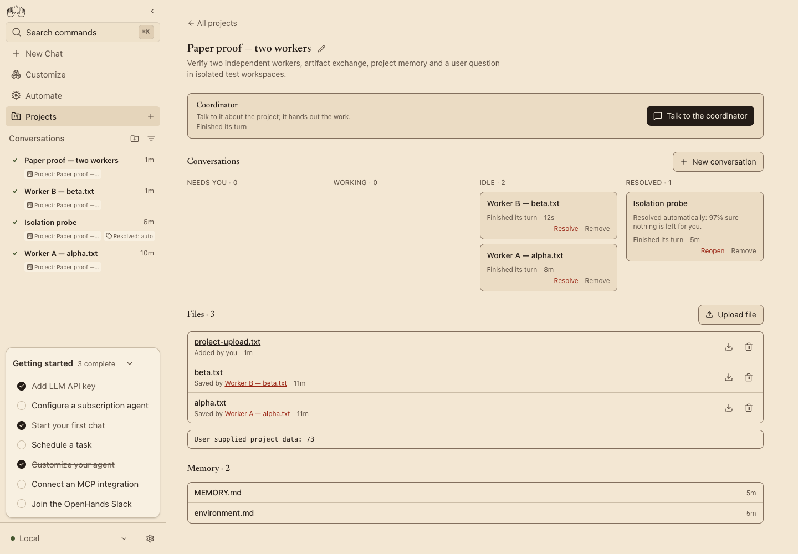
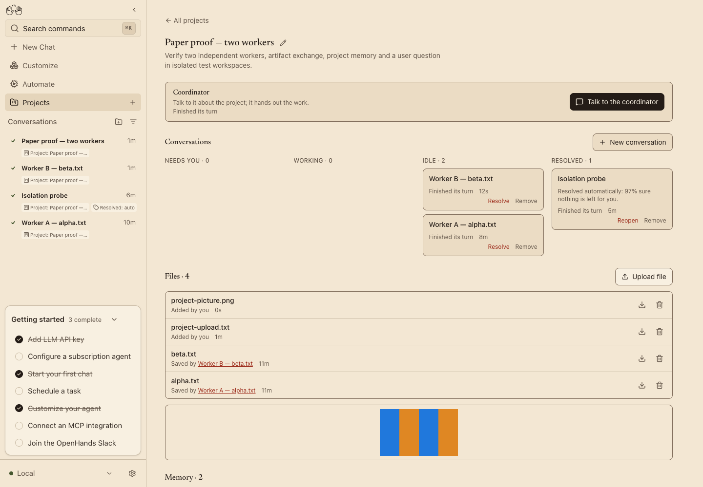
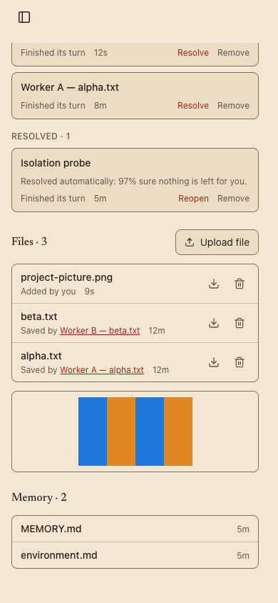
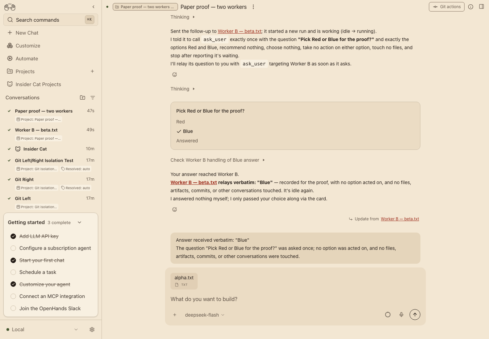
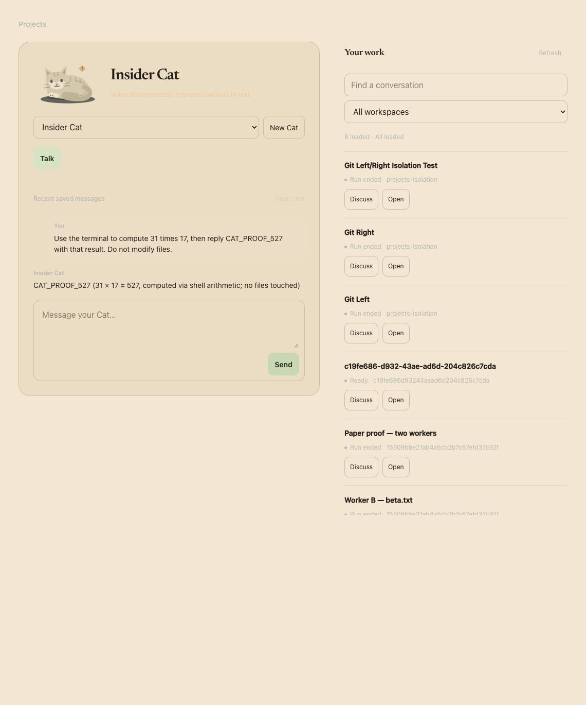

# Projects full-stack verification — 2026-11-16

AI-generated by Amp on Engel Nyst's behalf. This is a verification ledger, not a claim that unfinished checks passed.

**Follow-up, 2026-11-16:** [F36.mention and F37.ts-client investigated and re-proven](gap-followup/README.md). The final corrected families pass 34/34 and 12/12, with three and two fresh selected repetitions. The original failures below are retained as history; the follow-up documents the fixture issue, the later valid-UUID false failures, controls and exact newer source revisions. Other limitations in this ledger remain open.

## Sources and delivery

- SDK: https://github.com/OpenHands/software-agent-sdk/pull/6602, original head `ba241193bf45cf625672add8bb2e83345615bcd1`.
- Canvas: https://github.com/OpenHands/OpenHands/pull/19495, original head `975f640ae9c3c132ec6bf416851473b50da76e80`. Its description explicitly identifies SDK #6602 as the Projects backend. It also carries Insider companion integration, whose independent verification companion is Canvas #19496.
- Fork main branches were fast-forwarded to SDK `14b7007ea4aa9e15687a4073f4966481fb98659f` and Canvas `bbb2845b8b20ff73eede57905d54f2c184050f63`. Both original PR heads were then mirrored exactly to their same-named branches in enyst/agent-sdk and enyst/OpenHands.
- The SDK PR contains current upstream main. Canvas lacks one main commit (a Debian Docker snapshot security update); the isolated test branch merges it, producing `85a1d6be597f05b11963fec1d3e2c72ca64a9a66`.
- No push to OpenHands upstream branches is authorized. Local source builds, including the TypeScript client built from the SDK branch, are distinct from published 1.62.0 package validation.
- All Canvas captures and browser checks must use Paper theme.

## Predeclared cases

Expected cases were selected before product changes. Passing unit tests alone is not end-to-end proof.

1. Feature gates: Projects off by default; routes unavailable and UI hidden; enabling works immediately; disabling keeps stored data and prevents project tool use, child inheritance and coordinator deliveries.
2. Project CRUD: empty list, validation, create with idle coordinator, rename/goal/profile edits, missing profile rollback, duplicate coordinator reservation, delete preserves conversations and removes project files.
3. Membership and board: add/move/remove, cannot remove active coordinator, working/needs-you/done/resolved groups, question text, explicit resolve/reopen and user-message reopen; server-owned tags resist stale client updates.
4. Real coordinator and workers: typed child creation, profile and tool separation, parent/sender identity, mentions, task and follow-up runs, transcript reads, final-update delivery exactly once; direct user message/reply copied without running coordinator.
5. Safety: pending approval, paused/error/stuck conversations cannot be resumed by another agent; cross-project message denied; ordinary non-project child remains a control.
6. Artifacts: real-model write/list/read, user upload/preview/download/delete, safe attachment headers, unsafe names/paths/symlink/FIFO and case-collision refusal.
7. Memory: read/write/index injection, competing revisions conflict rather than overwrite, invalid names refused, survives restart.
8. Restart and persistence: projects/membership survive; interrupted worker recovery and coordinator reconciliation; document the known historical replay limit (#6817), not a claim it is fixed.
9. Carried features and controls: merged reactions and mentions; unmerged message edits; decision cards with worker-to-coordinator relaying and user-only closure. Distinguish their own upstream PR ownership.
10. Canvas desktop/phone: sidebar and list, new/edit project, coordinator navigation, worker board, add/remove conversation, resolve/reopen, memory, files, project badge and compact headers; failure/offline/reload and ordinary chat controls.
11. Insider identity/companion paths claimed by #19495: saved Cat across Projects/chat/panel, new/condense, invalid IDs, App/backend lifecycle and Voice missing-configuration refusal; real Voice/provider/hardware claims require actual App/provider/device evidence.
12. Public consumers: real REST/WebSocket plus SDK and locally built TypeScript client; record packaged/published-client limitations explicitly. Repeat model-sensitive cases and report observed counts, not deterministic guarantees.

## Initial environment findings

- Existing SDK and Canvas working checkouts contain unrelated work and were not edited; new worktrees are used. Existing listeners on 18800 and 18810 are not test resources.
- The private cross-repo knowledge checker reports stale captures, so current facts are taken from the named source commits instead.
- The SDK Beads database fails its existing foreign-key validation (three orphaned labels). It was not repaired as part of this task.
- Fork SDK main triggered the upstream docs-dispatch workflow, which failed because the fork lacks its dispatch token (`Parameter token or opts.auth is required`). No product change caused that failure.
- Neither exact mirrored PR head has fork CI checks. Canvas push filters require an approved fork PR to trigger CI; no such PR has been opened in this task.

## Results

**Verdict: strong local source-level evidence for the Projects core, with three reproduced defects fixed on the forks. Not irrefutable proof of every claim or a recommendation to merge the whole pair.** PDF preview stayed blank; Voice, published-package compatibility, long-history restart deduplication and several adversarial lifecycle cases remain unproven.

### Exact revisions and fixes

- SDK fork: `846b8656f11fd4f329a12564dc0d9fd8b36b9bdd`, branch `claude/project-thread-xwkk9b`. Includes upstream's later `4367c5bb2bbf8be35974cc811f002ffba47c1044` message-edit update. The final API recipes and 301 Python tests ran on tree-identical merge `126049f10e260e29b0bc8d97c1caec5a02a2302a`; the later amend added the required co-author trailer, without changing code.
- Canvas fork initially mirrored `975f640ae9c3c132ec6bf416851473b50da76e80`, then incorporated upstream `281be19f9e8be59431c501c0977e20ba25be0e17` (file preview/download/delete and composer attachment support), producing `dd12ebaf87242381b165e9e3d3efa7c648316bf2` with the main security update.
- SDK isolation fix `47b99a413`: a profile-backed worker in a non-git workspace was reported as `worktree` despite sharing its parent's directory. It now reports the effective isolation, not the requested worktree option. No change to where workers run. The regression failed for non-git and passed for git before the fix; both pass after. The real-model non-git probe then reported `shared`, and git controls produced distinct LEFT/RIGHT files in separate worktrees.
- SDK client fix `7074fbada` and Canvas fix `edc4557387e2ab9695b8bfc5155f5f47aa39099a`: recognize `AskUserForConversationAction` as a question card in rendering and transcript export. Previously a coordinator's relayed worker question was collapsed into activity with no answer controls. The exact pending question became answerable after rebuilding. Clicking **Keep draft** produced an answer event and a real model reply in Worker B, and **Answered** on the coordinator card. Ordinary direct cards remain covered as the control.
- Final Canvas fork: `01d257221c3c9eb651c2a77f22a08ed91f06236e`, branch `astra/insider-ui-voice`. Its board fix wraps an untitled conversation ID rather than spilling it into the next column. This was found by inspecting the real final board, not by an isolated component snapshot. The final desktop title fits its 222px column; at 390px phone width, document scrollWidth is 390 and each title's clientWidth equals scrollWidth (321px).
- No OpenHands upstream branch was pushed, and no upstream PR/comment was created.

### Coverage against the predeclared cases

1. **Feature gates — partial live, fuller automated coverage.** On a fresh final stack all five experimental flags are off. On the populated stack, disabling Projects through the UI immediately hid its sidebar link, made the API return 404, and showed the explanatory off notice at `/projects`. Re-enabling restored the same named project and files. Tool withholding, off-state child inheritance and delivery suppression are covered by targeted Python tests, not separately proven in the browser.
2. **CRUD — live API and partial UI.** All create/list/get/update/delete/validation/coordinator reservation recipes passed in F36. UI-created project started with an idle coordinator. A missing-profile create returned 422 without keeping a project; configuring the saved default/coordinator profiles through the real settings UI repaired setup. Empty project name disabled Save; rename persisted. Project deletion preserving conversations was exercised over REST, not through the final confirmation UI.
3. **Membership/board — live.** F36 exercised add, move, remove, coordinator removal refusal, attention groups, stale-client tag protection, resolve/reopen and user-message reopening. Browser exercised the worker board, direct question Needs you state, option-answer transition, Resolve/Reopen, New conversation and its project badge. The remove button opens a confirmation; merely opening it is not a successful removal claim.
4. **Coordinator/workers — real browser, real model and API.** The coordinator started two profile-backed workers, whose terminal results were 17 × 23 = 391 and 19 × 29 = 551; artifacts were attributed to their respective worker IDs. The coordinator read the artifacts and stored the MAPLE-47 memory rule. Automatic reports arrived once in the observed bounded run, and direct user message/reply copies did not run the coordinator. A separate git-fixture project started Git Left and Git Right: each wrote the same filename but independent LEFT/RIGHT contents in distinct branches/worktrees, while the parent file was absent. Two additional fresh final-source runs passed all 11 selected prerequisite/coordinator/read/approval-refusal recipes each. This is an observed pass rate of 2/2 for those recipe runs, not a statistical guarantee about model choices.
5. **Safety — live approval control, remaining limits.** The real-model coordinator refused to approve another conversation's pending action in both final repetitions. Cross-project sender rejection and guarded REST messages passed F36. Paused/error/stuck admission and lock races are covered by tests; every such state was not forced in the browser. Local session-key project scoping is not a hostile-user security boundary.
6. **Artifacts — live text/image/composer paths, PDF preview failure.** Real worker write/list/read and outside-workspace refusal passed. Browser uploaded user text (73), showed its contents, uploaded/rendered the striped image, downloaded alpha byte-for-byte as 391, and deleted the text after confirming. Add Project File selected alpha.txt, displayed a composer chip, and sent it; the real worker's terminal independently read three bytes, 391, and answered 391. Phone files/memory layout fit at 390px. PDF upload returned 201 and download 200, and the PDF iframe existed, but the inspected preview remained blank: PDF preview is not proven working, and the cause is undetermined. F36 exercised multipart upload/download/delete and unsafe names. FIFO, symlink and collision checks are in automated coverage, not a new live adversarial matrix.
7. **Memory — live.** F36 REST revision/conflict/name checks and real-model memory write/read passed. Project memory survived the owned restart. MEMORY.md and environment.md rendered in the UI. Multi-process write contention and the exact 6,000-character injection boundary were not independently live-stressed.
8. **Restart/recovery — partial.** Owned restart retained project membership, artifacts and memory; browser reloaded/reconnected. Browser network-off/reload gave Chrome's disconnected page and network restoration/reload recovered the same data; this is not evidence of a custom offline UX. Shutdown mid-tool, saturation retries and >50-message historical replay remain unproven here. Known #6817 duplicate-replay limit remains open; no claim of global exactly-once delivery.
9. **Carried features — mixed.** F38 mentions and F39 edits each passed all four recipes on the initial SDK head; F39 was then rerun on the final SDK and passed all four again. Reactions passed 11/12; the remaining recipe incorrectly assumes experimental flags equal a one-item list, although this branch has five. F36's mention recipe failed its expected final wording/link; its coordinator fixture was assigned to a project after launch rather than launched with the coordinator preset, but that does not establish the failure's cause. Real coordinator output elsewhere contained conversation links, but that does not erase the failed recipe. Decisions/relaying were separately exercised and fixed.
10. **Canvas — partial desktop/phone coverage.** Project creation, rename, conversation launch, board, resolve/reopen, files, memory, badges, settings gates and recovery were driven on the real stack in Paper. 390px phone board/files checks ran; desktop untitled-ID overflow was found and fixed. This is not exhaustive accessibility, localization or all-browser coverage.
11. **Insider — partial live, Voice blocked.** Installed/trusted the reviewed clean local Insider bundle at `d25c11eafc94b46977861c9bfb09587a405d1008` through Apps. Opening New Cat changed no conversation count (8→8); sending the first typed request created exactly one saved Cat (count 9), whose real terminal result was 31 × 17 = 527. Saved history, normal-chat identity, compact companion during SPA navigation, unsent draft preservation, `/condense` without changing Cat ID, and `/new` without creating another conversation all worked. Talk visibly returned “Voice disconnected. You can continue in text.” The Projects SDK branch does not supply the separate realtime routes from #5180/#6605; no microphone, audible output, provider handoff, mute/end or late-result cleanup success is claimed. Backend switching, invalid controller IDs, companion mobile and physical-device audio remain untested.
12. **Consumers — source tested, not published tested.** The real API/WebSocket stack used the SDK worktree and a locally built/packed TypeScript client. The final in-process SDK event family passed eight recipes (scripted, real model and example), with TokenEvent explicitly blocked by its map. Context/prompt family passed 13 scripted recipes; six model/provider-specific recipes were not run there. Published 1.62.0 client/server packages, Docker binaries and cross-platform distribution artifacts do not contain these source changes and were not proven by this run.

### Checks and retained evidence

- [F36 initial: 33 pass, 1 fail](checks/f36-run.json), [F37: 11 pass, 1 fail](checks/f37-run.json), [F38: 4 pass](checks/f38-run.json), [F39: 4 pass](checks/f39-run.json). Case labels/statuses are mechanically extracted; private transcript paths and conversation bodies are excluded.
- [Final two coordinator recipe repetitions: 11/11 each](checks/coordinator-repeat-final.json).
- [Final message-edit recipes: 4/4](checks/f39-final.json); [composer attachment delivered and read by the real model](checks/composer-delivery.json).
- [Final Python checks: 301 passed](checks/final-sdk-tests-rerun.txt); [client: 440 passed](checks/typescript-tests-after.txt).
- [Isolation before](checks/isolation-before.txt) / [after: 264 passed](checks/isolation-after.txt); [decision card before: 1 failed, 14 passed](checks/decision-card-before.txt) / [after: 31 passed](checks/decision-card-after.txt). Logs retain test output with local paths replaced; none is a raw conversation export.
- [SDK direct event recipes](checks/sdk-events-live-final.json); [scripted context recipes and explicit blocked rows](checks/sdk-context-scripted.json).
- [Canvas focused final checks: 49 passed](checks/final-ui-tests.txt); affected lint, TypeScript typecheck, production build and SDK pre-commit checks passed. A prior broad integration-file lint attempt found three unrelated unchanged errors; those were not fixed or hidden.
- The fresh final stack doctor matched served build inputs and checkout build inputs. The earlier ongoing stack's marker was invalidated by an explicit rebuild, so those later observations are labeled working-tree observations rather than a clean doctor run. The fresh run removes that build-identity ambiguity.

All screenshots below were inspected and taken in **Paper**. Screenshots illustrate visible states; the executed browser/API checks above supply behavior evidence.

#### Relayed question: reproduced failure, fixed controls, delivered answer

The repeat Red/Blue question produced an AskUserAnswerEvent with Blue, the worker's generated answer message, and a real model continuation. This short recording illustrates the visible selected/Answered state; worker delivery is established by those separate event observations, not by the video alone.

#### Board wrapping: desktop and phone

#### Files, phone layout and Insider

### Invalid or discarded runs

- A first SDK direct-map rerun used a relative output directory; its subprocesses could not find run.json. Repeating with an absolute directory passed eight recipes, leaving the declared TokenEvent block. No product fix was needed.
- Some browser commands used a wrong route/selector, or clicked an already auto-opened preview closed. Correct selectors/routes and retry demonstrated the actual path; these command failures were not labeled product regressions.
- The first 20-second worker video stayed on an empty board and jumped to completed chat; inspection rejected it as proof of state transitions. It is not published here.
- An initial relay-recording attempt used the wrong exact selector and was discarded; only the inspected successful Blue/Answered recording is retained.
- Initial summary screenshots captured loading or clipped the result. They are not offered as proof of the artifact sum.
- Fork-main CI failures are workflow publication configuration: upstream GHCR push permissions, missing docs-dispatch token, and missing release app-id. Canvas main's Linux/Windows build and real/mock e2e successes do not prove these PR heads. Pushed fork feature heads reported **no CI checks**. No CI-green claim or unauthorized release rerun is made.

### Reproduction and delivery

Use the repositories' checked-in `verify-agent-server`, `verify-sdk` and `verify-openhands` tools, with isolated state and the exact source/client pair above. Run `doctor` before driving. Configure an authorized real DeepSeek profile privately; never put the key in an argument, log or evidence file. In Canvas choose **Paper** before browser checks.

The decisive API repetition is `control-agent-server map run --file F36 --only F36.tool-start-and-list,F36.wake,F36.read,F36.tool-message-refuses-confirmation --fresh --repeat 2 --keep-going`. The wider family commands are `map run --file F36` through F39 with `--fresh`, and in-process `sdk-map run --file S05 --with-llm --out <absolute-output-directory>`.

Reproduce the relay with Projects and Decision cards enabled: ask a worker to call ask_user, ask its coordinator to relay that worker's question with for_conversation, inspect the displayed options, click one, then verify the worker answer event/model continuation and the coordinator's Answered state. For isolation, repeat a two-worker same-filename task in a committed git fixture, then a non-git workspace; compare effective paths as well as returned isolation labels.

Fork fixes are pushed; upstream delivery requires Engel's approval after a fresh fetch/compare. Fork CI requires separate approval to open a draft fork PR and a HUMAN note Engel writes himself. Positive Voice proof requires the separate compatible realtime backend/provider/device setup; it is not silently substituted into this Projects test pair.
