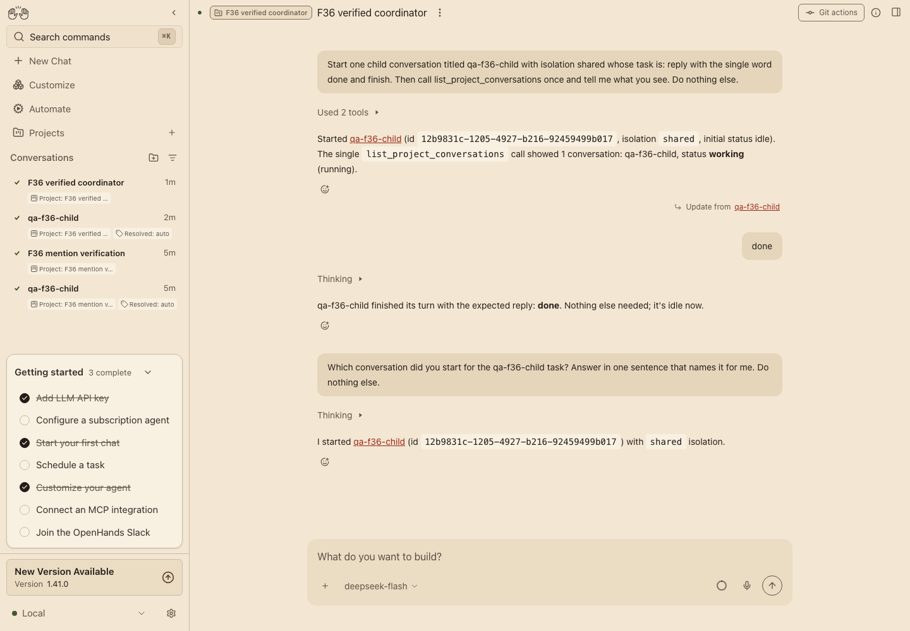
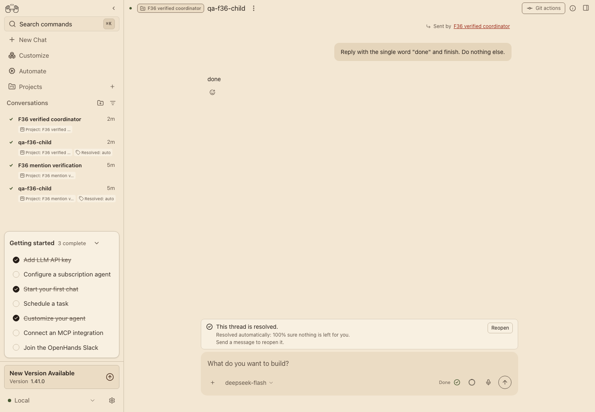
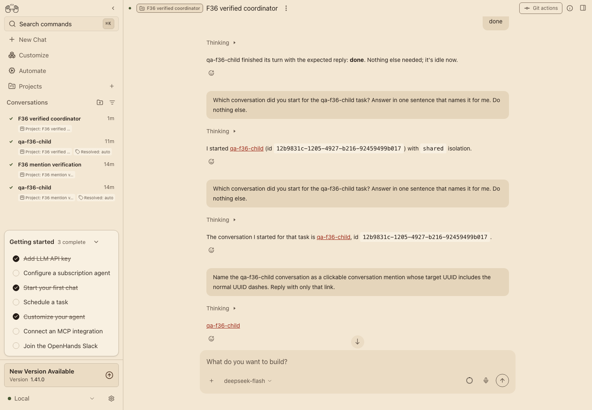
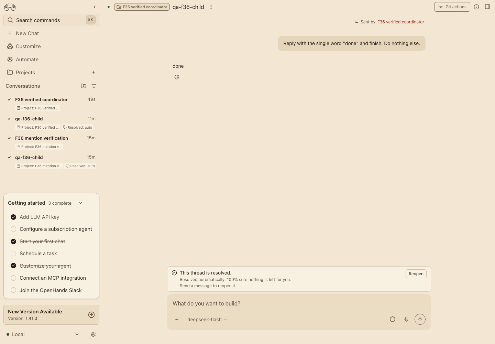

# F36.mention and F37.ts-client verification follow-up — 2026-11-16

AI-generated by Amp on Engel Nyst's behalf. This supplements the [original ledger](../README.md); its original failures remain historical observations, not erased results.

**Latest update:** [SDK PR #6908](https://github.com/OpenHands/software-agent-sdk/pull/6908) now retains upstream's independently corrected F37 recipe unchanged. Its only remaining diff is F36. See the [merge-resolution rerun](#merge-conflict-resolution--2026-11-16) below; the earlier stricter F37 assertion and its duplicate-flag controls are historical evidence, not the current target-branch assertion.

**Verdict: both named verification gaps are closed on the local source stack. No product runtime change is needed for these failures.** The corrected final F36 family passes 34/34 recipe blocks, F37 passes 12/12, and their selected recipes pass three and two additional fresh repetitions respectively. This is bounded evidence, not a guarantee about every future model response or every claim in the original Projects PRs.

## Exact source and delivery

- SDK parent PR: [OpenHands/software-agent-sdk#6602](https://github.com/OpenHands/software-agent-sdk/pull/6602), branch `claude/project-thread-xwkk9b`.
- Initial before/after comparison: frozen product source `b1c001fdfae17917be2c3423cc20f596fc277f34`; only the verification recipes changed between those runs. The recorded checkout SHA is therefore identical on both sides.
- Final complete families and selected repetitions: `2a4b4e20c1d253bc56df2591e16c9166d5dd99d7`, based on upstream `1dd0cf8cf1123a9dd37e83511bab112a0a073f9a`.
- Delivered fork branch: `enyst/agent-sdk:verify/projects-gap-followup-20261116` at `50ee7821a67f202ed924cc647dee84be972f6fe1`. After the tests it merges upstream `b8fbf05f5164b7c92db9736c6429cc350d3b0575`; the resulting tree differs from the tested `2a4b4e20c` only in the terminal README. Runtime code, client code and tested recipes are unchanged.
- Browser: Canvas `6a8331920af5b4c505d42084764eaa33ba420c7f` from [#19495](https://github.com/OpenHands/OpenHands/pull/19495); isolated launcher restarted against SDK `2258f2e38fe1317d19bc80389c5aacf6d2bc9733`. The static UI was built with the local source client from the preceding `b1c001fdf` product tree, not the published package. SDK runtime `/server_info` in that Canvas stack reports `unknown` for build SHA; this provenance is from the launch configuration, not a claim of an embedded-SHA check. Direct API-map runs record their checkout SHA separately.
- All browser checks and inspected screenshots use **Paper**. No Canvas source or verification file changes are submitted by this follow-up. SDK verification can accompany SDK fixes; Canvas verification stays separate.
- The client build and 440 client tests passed on `5c5d9e60662d488a62653c4d1853f27270da3753`; client source is identical at the final tested and delivered heads. The verification CLI suite passes 74 tests after the final recipe correction.

## F36.mention: two distinct recipe defects

### 1. Coordinator fixture lacked coordinator instructions

The old recipe launched an ordinary agent, then attached that existing conversation as the project's coordinator. Attachment changes membership; it does not retrofit the built-in coordinator prompt. The test consequently expected mention behavior without arranging the role that teaches it.

On the same frozen product source and real DeepSeek Flash model:

- [Old recipe](checks/f36-mention-unchanged.json): 3/3 fresh attempts failed. The final answers named the correct worker but contained no conversation link.
- [Preset-corrected recipe](checks/f36-mention-corrected.json): 3/3 fresh attempts passed. It requests `agent_launch_additions.prompt_preset = project_coordinator` at launch and checks the real `SystemPromptEvent` for the routing guidance before asking the question.
- [Selected synthetic QA answers](checks/mention-selected-qa-answers.json) preserve the actual before/after text, without exporting whole conversations.

The user question is unchanged:

> Which conversation did you start for the qa-f36-child task? Answer in one sentence that names it for me. Do nothing else.

Native UI project creation independently produced a coordinator that linked to its real worker when asked this same question. No product prompt was rewritten to accommodate the test.

### 2. Compact-only assertion rejected valid dashed UUIDs

After updating to newer upstream source, the full family passed but [two selected repetitions failed](checks/f36-mention-delivery-repeat.json). Inspection showed both answers **did contain a correct link**; its UUID included normal dashes. These are retained as intermediate false failures, not silently relabeled green runs.

Canvas's existing [conversation mention parser](https://github.com/OpenHands/OpenHands/blob/6a8331920af5b4c505d42084764eaa33ba420c7f/src/components/features/markdown/conversation-mention.tsx#L10-L21) accepts compact and dashed UUIDs case-insensitively. The recipe now accepts either standard spelling of the exact child UUID. It still requires the `conversation:` link, rather than a name or bare ID.

[Thirteen assertion controls](checks/mention-uuid-assertion-controls.json) show that compact, dashed and uppercase forms pass; a raw ID, name only, wrong child, extra dash and wrong scheme fail. Replaying the three original no-link answers still fails. Replaying the two intermediate dashed-link answers succeeds, with expected child IDs independently obtained from the saved tool listings, not derived from the answers under test.

Final real-model runs at `2a4b4e20c`:

- [Complete F36](checks/f36-full-uuid-corrected.json): **34 passed, 0 failed**.
- [Three fresh F36.mention repetitions](checks/f36-mention-uuid-corrected-repeat.json): **3/3 passed**, with all four prerequisite/selected blocks passing in each run.

This corrects the fixture and observable contract, not the original natural-language question. The preset-only intermediate results remain visible in the checks directory.

## Browser proof: real model, actual links, real worker

The original question produced a real coordinator reply containing `qa-f36-child`; clicking its rendered mention opened the matching child, which had actually answered `done`.

- [Rendered link target](checks/gap-browser-link.json), [executed click and resulting URL](checks/gap-browser-click.json), [worker answer](checks/gap-browser-worker-answer.json).
- [Paper theme and worker path](checks/gap-browser-theme.json), [no application/page errors](checks/gap-browser-errors.json).




A separate **explicit syntax control**, not a replacement for the unchanged question, asked the same real model to use a dashed UUID. Its [actual answer](checks/gap-browser-dashed-answer.json) was `[qa-f36-child](conversation:12b9831c-1205-4927-b216-92459499b017)`. The real browser [clicked it](checks/gap-browser-dashed-click.json), navigated to the normalized child URL and [read the worker's answer](checks/gap-browser-dashed-worker.json). No injected message or mocked response was used.




Screenshots illustrate endpoint states; the executed commands and observed targets establish navigation. Short recordings were inspected but did not clearly show the pointer click, so they are not offered as proof. An overly broad `article` selector briefly failed its strictness check after navigation; the scoped agent-message observation above is the successful retry.

## F37.ts-client: feature-list assertion was too broad

The old assertion required the **entire** experimental-feature response to equal one enabled reactions flag. This branch correctly returns five flags, so it aborted before exercising the client reaction operations.

- [Unchanged recipe](checks/f37-ts-unchanged.json): **2/2 failed**.
- [Corrected recipe on the same product source](checks/f37-ts-corrected.json): **2/2 passed**.
- The correction requires exactly one enabled `conversation_reactions` entry while allowing unrelated flags. [Controls](checks/f37-assertion-controls.log) accept unrelated/reordered flags and reject missing, disabled and duplicated reaction entries.
- The add/remove operations, unknown-feature 404, invalid-target errors and independently retrieved persisted `ReactionEvent` assertions remain in the recipe and actually execute.
- Final [complete F37](checks/f37-full-uuid-corrected.json): **12 passed, 0 failed**. [Two final fresh TypeScript-client repetitions](checks/f37-ts-uuid-corrected-repeat.json): **2/2 passed**, all three prerequisite/selected blocks passing each time.

## Supporting checks, failures and limits

- [Client production build](checks/client-build-delivery-rerun.log) and [440 client tests](checks/client-tests-delivery-rerun.log) pass. [74 verification CLI tests](checks/verify-tests-uuid-corrected.log) pass, with one pytest deprecation warning. [Map check](checks/map-check-delivery.json) validates 1048 IDs. [Pre-commit](checks/gap-precommit-delivery.log) passes.
- A newer upstream merge temporarily duplicated message-edit declarations and exports, breaking the client build. The [failure log](checks/gap-latest-client-build.log), [intermediate F37 full result](checks/f37-full-latest.json) and [repetitions](checks/f37-ts-latest-repeat.json) remain. The incomplete build left unusable dist imports; those runs are not evidence about the reaction behavior. Upstream independently repaired the duplicates in `1a0ae84e1` and `1dd0cf8cf`; the final follow-up has **no client-code diff** against upstream. An intermediate rebase also reapplied duplicate removals and was rejected by tests before the final source was frozen.
- [Full client lint](checks/gap-final-client-lint.log) still has three pre-existing errors in two unchanged integration test files; this follow-up does not claim a clean full lint run or fix unrelated code.
- The fork feature push has no CI checks. Local checks are not described as CI-green; no release or deployment workflow was manually triggered.
- This is **source-built local-stack proof**, not published-package, Docker/binary, Cloud deployment or cross-platform proof. In particular, published 1.62.0 does not establish support for these unreleased features.
- The original ledger's other limits remain: Voice's separate backend/provider/device setup, blank PDF preview, long-history replay and the other untested lifecycle cases are not closed by this follow-up.
- F36 was not invented for this investigation: Claude added the family in `0b917f474f62f55d7e884244fe621e25266c9b12` and its mention recipe in `f4f7a2728f0db9a3f1071ccc3200194e4dd505fd` on the Projects branch. The SDK verification changes belong with the SDK PR; nothing is moved into the Canvas product PR.

## Reproduce

In the SDK checkout, run `make build`, build `clients/typescript` with `npm run build`, and put `.agents/skills/verify-agent-server/scripts` on PATH. Supply the authorized DeepSeek key privately as `DEEPSEEK_API_KEY`; never put it in the command text or evidence.

```sh
control-agent-server map run --file F36 --fresh --keep-going --record
control-agent-server map run --file F36 --only F36.mention --fresh --repeat 3 --keep-going --record
control-agent-server map run --file F37 --fresh --keep-going --record
control-agent-server map run --file F37 --only F37.ts-client --fresh --repeat 2 --keep-going --record
uv run pytest tests/cross/test_verify_agent_server_skill.py -q
control-agent-server map check
```

For browser verification, use Canvas's `verify-openhands` launcher with the named source SDK/client, isolated state and Paper theme. Create a project through the UI, ask its coordinator to start `qa-f36-child` with task `reply with the single word done and finish`, ask the unchanged question above, click the answer's mention, and verify the child path and answer. Repeat with the explicitly requested dashed form only as the separately labeled renderer control.

## Merge-conflict resolution — 2026-11-16

The Projects target independently changed the same F37 flag assertion in `dec70fd3602fd6cd0ec7035ff80ebca68ded6f9b`, causing a textual merge conflict. Fork merge [b9bb0e962](https://github.com/enyst/agent-sdk/commit/b9bb0e962c6f3c3f01a37f7bccb62677da8cdeb4) keeps upstream's entire F37 recipe unchanged, including its terminal-only observation count. The sole PR diff is now `F36-projects.md`. No upstream branch was overwritten and no published history was rewritten.

At that exact merge commit, [all 12 F37 blocks pass](checks/f37-conflict-resolution.json), [two fresh F36.mention repetitions pass](checks/f36-conflict-resolution-repeat.json), and [121 reaction, message-edit and verification-tool tests pass](checks/conflict-resolution-tests.log), with 37 warnings. The [map check](checks/map-check-conflict-resolution.json) validates all 1048 IDs. These reruns use a real model where required and the locally built client; the earlier source/published-package and browser-snapshot limitations remain.
