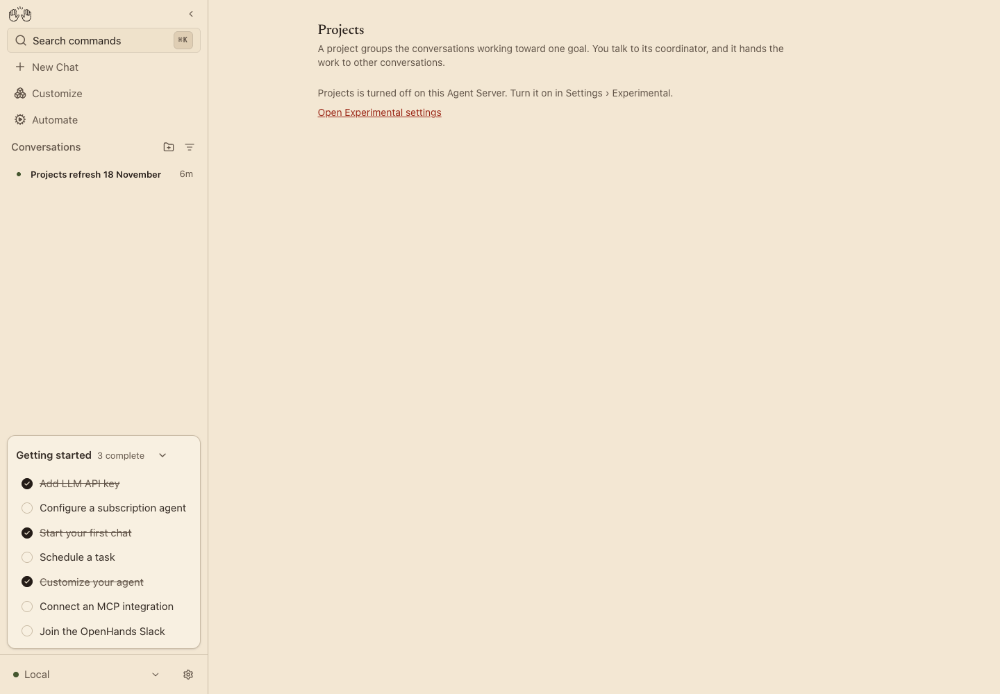
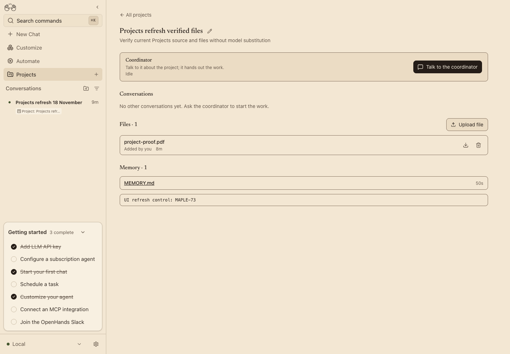
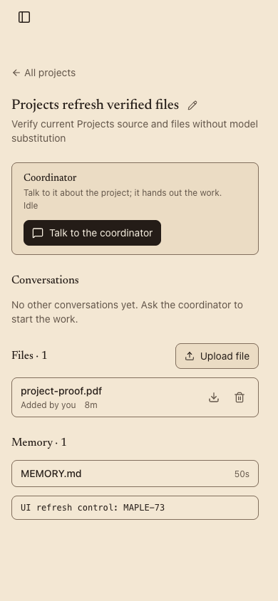
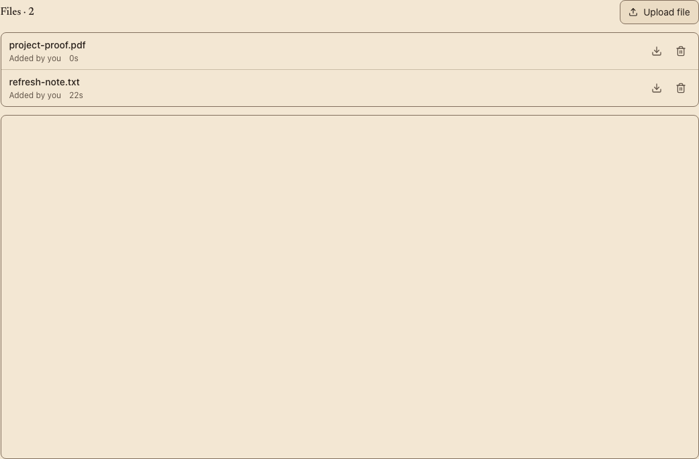
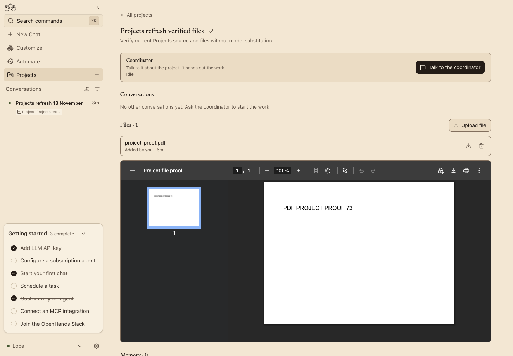

# Projects refresh — 18 November 2026

AI-generated by Amp on Engel Nyst's behalf. All Canvas observations and screenshots use **Paper**.

**Verdict: the refreshed source passes the checks below, including live flag-off/on controls, but the requested comprehensive real-model proof is blocked. Do not interpret this as approval to merge either large PR.** The saved DeepSeek Flash connection reaches the provider, which returns **Insufficient Balance**. No mock was substituted for the required real-model happy paths. The earlier [16 November evidence](../2026-11-16/README.md) and its [follow-up](../2026-11-16/gap-followup/README.md) remain intact; their model successes do not certify these newer heads.

## Exact inputs and fork state

- SDK [#6602](https://github.com/OpenHands/software-agent-sdk/pull/6602): [05a8f915e85e8f1617335e057405873ece833d27](https://github.com/enyst/agent-sdk/commit/05a8f915e85e8f1617335e057405873ece833d27), mirrored exactly to `enyst/agent-sdk:claude/project-thread-xwkk9b`.
- Canvas [#19495](https://github.com/OpenHands/OpenHands/pull/19495): [19a775389917519c32ff5e1958c211cd7fb1d427](https://github.com/enyst/OpenHands/commit/19a775389917519c32ff5e1958c211cd7fb1d427), mirrored exactly to `enyst/OpenHands:astra/insider-ui-voice`. Its description explicitly names SDK #6602, confirming the pairing.
- Fork mains updated from upstream: SDK [0e65866791ae8545ea66f06e4e2949c006b3e37e](https://github.com/enyst/agent-sdk/commit/0e65866791ae8545ea66f06e4e2949c006b3e37e), Canvas [31c57c207be72d0a228ea7a7e68a3a81bc98bdd5](https://github.com/enyst/OpenHands/commit/31c57c207be72d0a228ea7a7e68a3a81bc98bdd5). Fetch/compare preceded pushes. No upstream branch was pushed and no product fix was made in this refresh.
- Initial refreshed SDK was [77d30c55f6a4882145abdc23df1f24e3df238954](https://github.com/enyst/agent-sdk/commit/77d30c55f6a4882145abdc23df1f24e3df238954). Upstream advanced during testing. The final head changes only `clients/typescript/src/__tests__/api-clients.test.ts` (5 insertions, 3 deletions): replace a non-null assertion with an explicit unexpected-fetch error. Runtime source is identical. Python, stress and client tests were rerun at the final head. The API server was explicitly restarted with `--checkout`; its doctor confirms `build_git_sha=05a8f915e85e8f1617335e057405873ece833d27`.
- The browser stack uses the isolated Canvas checkout and the local SDK path. It was restarted after the SDK update. Canvas's doctor verifies the served frontend build fingerprint and revision `19a775389917`, local SDK pin and health. This launcher's backend `/server_info` reports `build_git_sha=unknown`, so its backend commit identity comes from the recorded source path and runtime-tree equality, not a server-reported hash. Do not conflate that with the separate API server's exact-hash doctor.
- GitHub reported **MERGEABLE** for both PRs at these heads. SDK #6602 is one upstream-main commit behind ([0e6586679](https://github.com/enyst/agent-sdk/commit/0e65866791ae8545ea66f06e4e2949c006b3e37e), ask_agent prompt-cache change); the PR mirror remains exact rather than silently merging that commit into it. The earlier conflict report is not current at this fetch.
- Separate isolated worktrees and owned test ports were used; the existing development checkouts and shared stacks were not changed.

### Split-out work is not counted as new Projects work

GitHub queries on 18 November confirm SDK #6759 (flags), #6609 (reactions), #6852 (ask_user), #6851 (mentions), and #6908 (verification recipe corrections) are merged. Contrary to the original brief's assumption, Canvas #19503 (flags/reactions) and #19789 (decision cards) are still **OPEN**. Their behavior is carried in this Canvas branch and must not be described as already shipped upstream. The refresh did not cherry-pick duplicates over the exact PR mirrors.

## Observed current-source results

### Flag off: working controls, not a universal non-interference proof

- Fresh browser: no Projects sidebar link. Direct `/projects` renders the explicit off notice with a link to Experimental settings; it does not expose project data. A literal claim that no Projects text exists anywhere would be false: the explanatory route and the feature switch remain intentionally visible.
- After creating and populating a project, switching Projects off hides sidebar navigation and project badges. The existing coordinator remains an ordinary conversation in the sidebar; its title is user data, not a Projects control. Its chat page has no project test IDs. Project REST reads return **404** while off, including existing-project memory reads.
- A conversation created with Projects off, explicitly requesting `terminal`, `list_project_conversations` and `read_project_memory`, receives **only terminal**, no project tag, and remains idle. This is a real create/get API check, **not** a model execution.
- Disabling Projects, restarting the owned API server, and re-enabling restores the same coordinator membership and the exact `Refresh control MAPLE-73` memory. Browser re-enabling likewise restores the same renamed project, PDF and memory.
- Existing-conversation tool execution, child inheritance and coordinator wake suppression with the flag off are covered by the targeted tests, **not newly proven with a live model**. Ordinary real-model chat/child behavior is also blocked. Therefore “nothing Projects-related runs and all existing behavior is unchanged” is not fully established by this refresh.

### Flag on: real UI/API paths that do not require a funded model

- Real browser project creation starts an **idle** coordinator. Empty edited name disables Save; a valid rename persists. The page and file list survive the owned full-stack restart and reload.
- Real browser text upload/preview/download/delete: preview contains control **391**; the downloaded file is 57 bytes and contains the expected text; cancelling Delete preserves it, confirming Delete removes it (button count becomes zero).
- A memory file arranged through the API renders through the UI: expanding `MEMORY.md` displays **UI refresh control: MAPLE-73**. This proves UI read/render, **not agent-authored memory**. API create/read, stale-revision **409**, disabled-route **404**, and restart restoration passed independently.
- A real existing conversation can be designated coordinator through the project update API; board membership reports it. Removing the active coordinator returns **409**. An earlier attempt to add membership using an invented PUT route returned **405** and is retained as a test-command error; membership is server-owned, not writable at that route.
- At 390px viewport the renamed project, PDF file and expanded memory are visible without overlap. DOM document width equals viewport width (**390px**). This is browser emulation, not a physical phone or mobile-Safari test.

### Reactions and recent event reads

Real API checks ran against the exact-hash final server:

- Add a user `heart` reaction, read its persisted event and verify the exact `target_event_id`; remove it and verify `removed=true`. Conversation remains idle; a reaction does not start an agent run.
- Invalid emoji: **422**. Unknown target: **400**. Reactions flag off: **409**.
- Get the exact saved message event: correct ID. Search with `limit=1`: exactly one item. POST batch `[existing_id, missing]`: ordered `[event, null]`.
- An initial assertion incorrectly required reaction `parent_id` to equal its target. It happened to pass when the target was the event-tree leaf, then failed after more events existed. `parent_id` is the event-tree link; `target_event_id` is the reaction target. The failure is retained; the corrected read verifies the persisted target field without changing product code.
- These are REST/persistence controls. Real-model reaction choice, mentions, edits and browser decision-card continuation were **not rerun successfully on these heads**. Their earlier successes stay historical.

See [mechanically extracted API statuses and assertions](checks/api-observations.json). This projection deliberately excludes conversation bodies, prompts and secrets.

### PDF: working native viewer, unsupported-viewer gap remains

The same original valid `project-proof.pdf` reproduced a blank iframe in the default verification browser. That browser reports `navigator.pdfViewerEnabled=false` and no PDF plugins ([observation](checks/refresh-pdf-dom.json)). Changing only the **owned browser** to installed full Google Chrome gives `pdfViewerEnabled=true` ([observation](checks/refresh-browser-environment.json)); after allowing the native viewer to settle, the PDF visibly renders **PDF PROJECT PROOF 73**, including after stack restart. Downloading is independent of the viewer.

This is evidence of a native-viewer dependency, not a product fix. A browser with no built-in PDF viewer still gets a blank preview with no explanatory fallback. Full-Chrome rendering does not prove Safari, Firefox, iOS or an embedded webview works. An immediate post-navigation screenshot was also blank because the native viewer had not settled; it was rejected as the final capture.

### Supporting checks and stress history

- Final SDK: **376 passed**, 166 warnings, in the focused project/router/flag/profile/prompt/card/reaction/event-service/tool tests. Existing warnings include an unawaited subscriber-close coroutine; no warning-free claim is made. [Output](checks/refresh-targeted-tests-latest.log).
- Full opt-in stress suite: **13 passed**, 2,157 warnings, **90.80s** at final SDK head; earlier refreshed-head pass also retained. Extra isolated bash-flood repetition: **1 passed**. [Final stress output](checks/refresh-stress-latest.log), [earlier output](checks/refresh-stress.log), [extra repetition](checks/refresh-flood-repeat.log).
- Historical CI stress failure: run [43948286321](https://github.com/enyst/agent-sdk/actions/runs/43948286321), at earlier SDK [b1c001fdf](https://github.com/enyst/agent-sdk/commit/b1c001fdfae17917be2c3423cc20f596fc277f34), `/health` p95 **3938.7ms**, budget **100ms**, during bash flood. The relevant test and budget are unchanged from that source. Current local non-reproduction does **not** establish the historical failure's root cause or guarantee CI latency. [Historical failure log](checks/refresh-historical-stress.log).
- Local TypeScript client: **448 passed**. Canvas: **41 component/utility tests plus 11 project-route tests passed**. Typecheck and production build pass with the **locally built client**. [Client](checks/refresh-client-tests-latest.log), [components](checks/refresh-ui-more-tests.log), [routes](checks/refresh-ui-route-tests.log), [typecheck](checks/refresh-local-typecheck.log), [build](checks/refresh-local-build.log).
- Agent-server map: **1,077 IDs**, 39 files, no problems. In-process SDK event map at the final head: **7 passed, 4 blocked** (three live-model bullets deliberately not enabled; TokenEvent is declared blocked). Scripted/fake-provider checks here are labeled as such, not real-model evidence. [Server map check](checks/refresh-map-check.json), [SDK map](checks/refresh-sdk-events.json).
- Published client **1.62.0** does not supply the Projects exports this Canvas branch imports: the [published-client typecheck fails](checks/refresh-typecheck.log). Replacing only the dependency with the locally packed branch client makes typecheck/build pass. This is **source-pair compatibility**, not published-package, Docker-image, binary or deployed-product proof.

## Full-ledger disposition

These map back to the twelve predeclared cases in the older ledger; unvisited cases are not silently promoted to passes:

1. **Gates:** current live browser/API off/on/data-retention controls pass; real-model off-state non-interference blocked.
2. **CRUD:** current create/edit/validation/coordinator designation and removal guard pass; full rollback/delete/collision matrix not newly live-replayed.
3. **Membership/board:** current coordinator membership passes; working/asking/needs-you/resolved transitions and worker membership/removal remain historical or automated-only.
4. **Coordinator/workers:** no successful current real-model delegation, reports, follow-up, mentions, read or worktree isolation run. Blocked by provider balance.
5. **Safety:** current route/tool-withholding controls plus tests pass; adversarial approval, paused/error/stuck, sender and wake cases not newly model-driven.
6. **Artifacts:** current text/PDF browser paths pass subject to native-viewer limitation; model write/list/read and unsafe-file adversarial live matrix not rerun.
7. **Memory:** current API conflicts/persistence and UI rendering pass; current real-agent write/injection blocked; multi-process contention and exact injection-size boundary unproven.
8. **Restart:** idle project/files/memory persist; shutdown mid-tool, saturation recovery and >50-message replay remain unproven. No global exactly-once claim.
9. **Carried features:** current reaction/event REST checks pass. Real-model reactions/mentions/edits/decision relay not successfully rerun.
10. **Canvas:** current Paper desktop/phone project/file/memory/gate paths pass; complete worker-board interaction, composer attachment, relayed user-only closure and ordinary real-model chat control blocked/not rerun.
11. **Insider/Voice:** not retested in this refresh. Prior Voice backend/provider/device limitations remain; no new audible/microphone/physical-device proof.
12. **Consumers/packages:** local source pair tested. Published 1.62.0 is an explicitly failing compatibility control, not a successful distribution test. Current SDK scripted event recipes pass, but real-model direct-SDK and TypeScript coordinator recipes remain blocked.

## Failures, invalid runs and CI

- [Initial F36 refresh](checks/refresh-f36.json): runner reports **0 pass / 34 fail**. [F37](checks/refresh-f37.json): **4 pass / 8 fail**. Both fail their first real-provider prerequisite with `insufficient_balance_error`. Downstream setup-dependent failures are **invalid proof**, not 34/8 established product defects. The original statuses and provider response are preserved in sanitized projections.
- UI creation initially returned 422 because the seeded active profile referenced a missing default LLM profile. Creating the explicit default profile repaired setup; it does not repair provider balance.
- Initial static frontend launch used a stale build marker; it was replaced with a clean build and a doctor-passing owned stack before the reported browser checks.
- Invalid routes/selectors and the invented membership PUT are not product failures. Memory content is behind a disclosure button: waiting for MAPLE-73 before expanding it was a test-command error; clicking `MEMORY.md` shows it.
- Three current recording attempts were rejected: one waited on collapsed memory, another captured no frames, and a nominally successful 2-second file omitted the off state on inspection. They are **not offered as roundtrip video proof**. Screenshots plus executed API/DOM checks support the limited current claims; a valid current end-to-end model video is still missing.
- Exact fork mirror heads have **no CI checks**. No draft fork PR was opened; Canvas requires an approved fork PR (and a human-authored HUMAN note) to trigger its PR CI.
- Fork-main publication failures: SDK/Canvas Docker jobs try to publish upstream GHCR images and fail with `permission_denied: The requested installation does not exist`; docs dispatch lacks its token; Canvas release-please lacks app-id. These are not silently fixed or rerun as releases. They are not Projects-branch test results.
- Separately, Canvas fork main [mock-LLM E2E run 44382527179](https://github.com/enyst/OpenHands/actions/runs/44382527179) has **1 failed, 82 passed**: `virtualizes long conversations into real message rows` timed out waiting for an older-page GET at line 667/694. Overall wrapper exited 124. This is **not** a publication-permissions failure. Main was an exact upstream mirror with no task-authored change; the timeout's product-versus-harness cause is not established here. Ubuntu/Windows build and live-e2e jobs passed on main; they do not establish PR-head success.

## Reproduce and next action

Use these exact source heads in isolated worktrees; build and pack the SDK's `clients/typescript`, install it into Canvas without changing its tracked lockfile, then build Canvas. Use the checked-in `verify-agent-server`, `verify-sdk` and `verify-openhands` tools, explicit run directories and `doctor`. Select **Paper** before browser work. The [predeclared refresh cases](checks/refresh-cases.md) record the original frozen head before upstream's test-only advance.

The remaining decisive action is to restore funding for the saved DeepSeek Flash connection, or authorize a specific funded alternative privately. Then rerun the full Projects/reaction/mention/edit maps, repeated coordinator/worker/refusal cases, the real browser worker-board and decision relay, and the ordinary real-model flag-off controls on a freshly frozen source pair. Never paste credentials into the evidence or thread. No upstream push is authorized by this report.
