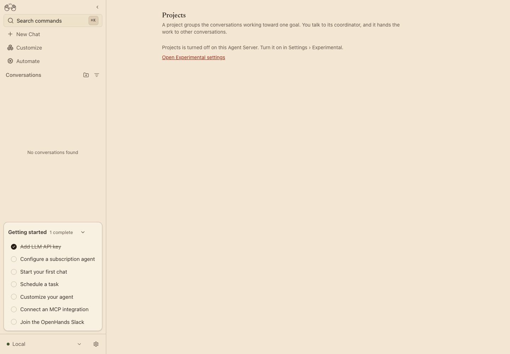
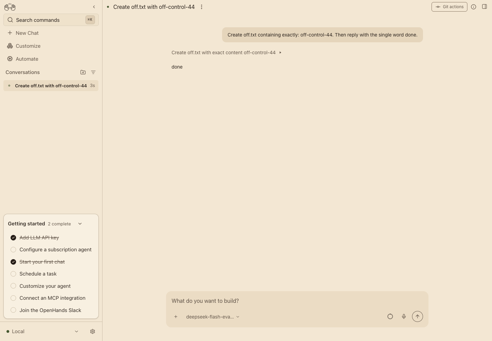
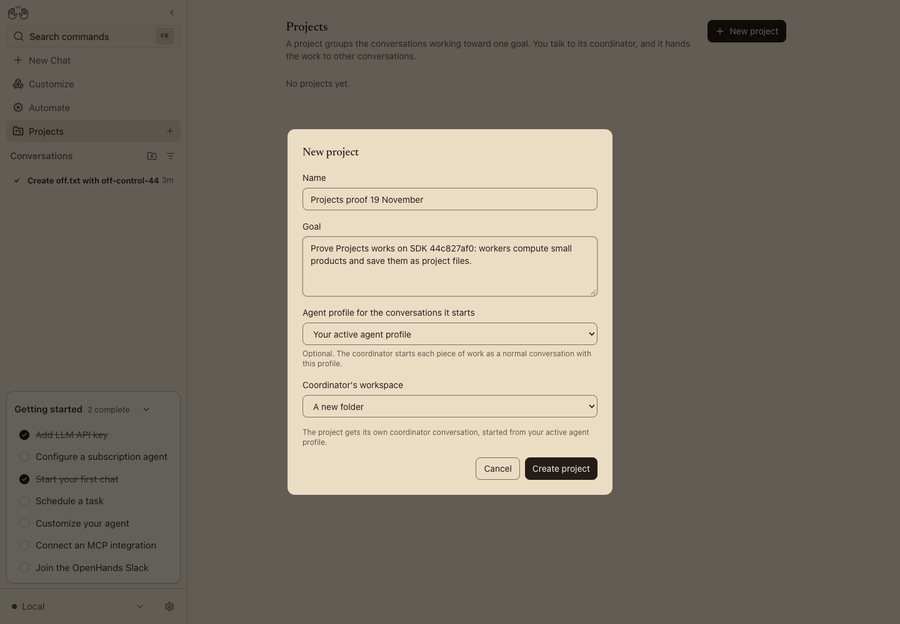
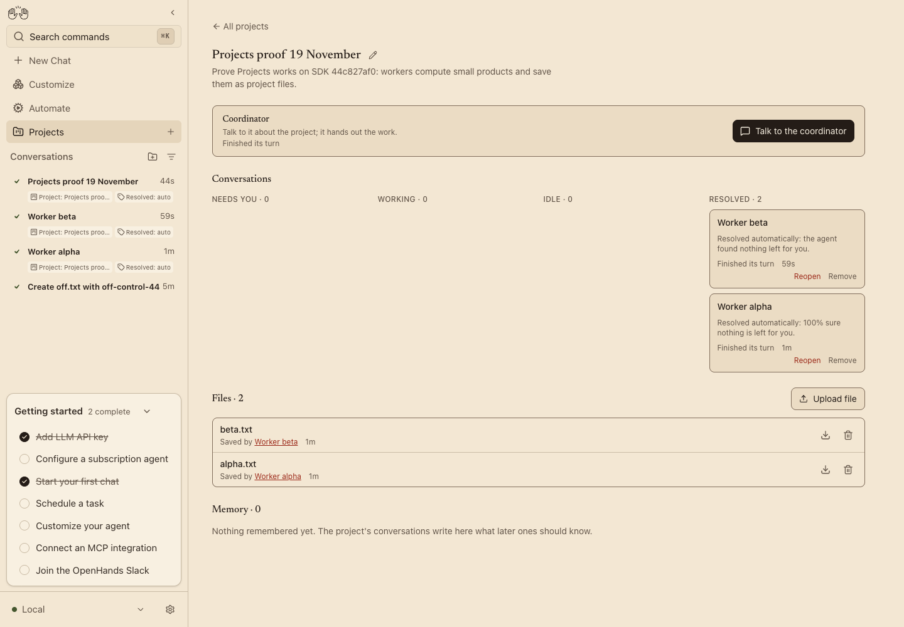
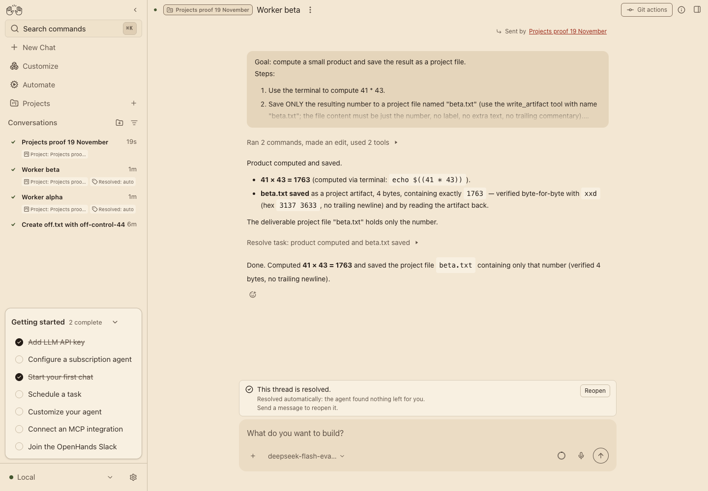
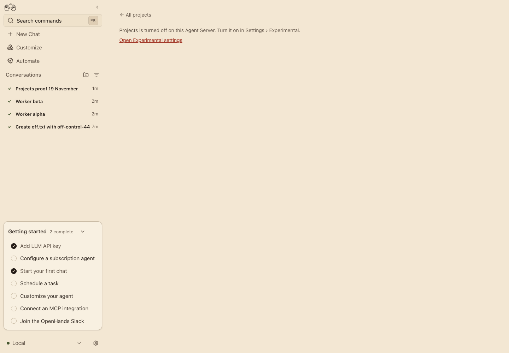
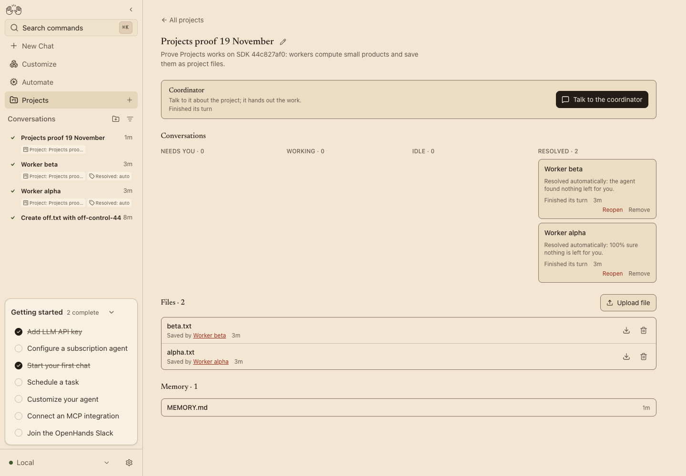

# Projects on the updated SDK head, flag off and on, real model — 2026-11-19

AI-generated by Amp on Engel Nyst's behalf. Earlier dated folders ([16 November](../2026-11-16/README.md), [18 November](../2026-11-18/README.md)) stay as they were, including their failures.

**Verdict: on SDK `44c827af0` with Canvas `19a77538`, Projects works with a real model when the flag is on, and stays out of the way when it is off.** One whole-family run had a model miss (kept below); three fresh reruns of that chain passed. One flag-off behavior differs from the feature map's wording and needs a decision. This is source-built local proof, not published-package or deployment proof.

## Exact source

- SDK [#6602](https://github.com/OpenHands/software-agent-sdk/pull/6602) head [`44c827af07bbed8b0989f56a8d5b66007104efc7`](https://github.com/enyst/agent-sdk/commit/44c827af07bbed8b0989f56a8d5b66007104efc7), 20 commits after the 18 November head `05a8f915e`. Fork mirror `enyst/agent-sdk:claude/project-thread-xwkk9b` fast-forwarded to it; fork main to upstream main `70ead0f45`.
- Canvas [#19495](https://github.com/OpenHands/OpenHands/pull/19495) head `19a775389917519c32ff5e1958c211cd7fb1d427`, unchanged since 18 November; fork mirror and fork main already exact.
- Canvas was rebuilt against the TypeScript client packed from the SDK head (its `projects-client.ts` changed: attention `asking`, turn `asking | finished`). The rebuilt bundle contains `asking` and no `needs_input`. The Agent Server ran editable from the SDK worktree; its `/server_info` build SHA reads `unknown`, so provenance comes from the process path.
- Model: DeepSeek V4.1 Flash through the All Hands LLM proxy (`litellm_proxy/deepseek-v4.1-flash`), validated with HTTP 200 before every run.
- Every browser check and screenshot is in **Paper** (`openhands-color-theme=paper`, chosen in Settings › Application › Color Theme). Full Chrome.

## Non-model checks

| Check | Result |
|---|---|
| Python tests changed by the PR (plus agent profiles) | [670 passed, 10 skipped](checks/python-tests.log) |
| TypeScript client | [449 passed](checks/client-tests.log) |
| Canvas Projects/decision/route tests, local client | [52 passed](checks/canvas-tests.log); [typecheck passes](checks/canvas-typecheck-local-client.log) |
| Opt-in stress suite | [13 passed, 77.3 s](checks/stress.log) |
| Agent-server feature map | [1,077 IDs, no problems](checks/map-check.json) |

The historical CI stress failure (run 43948286321, `/health` p95 3938.7 ms) still does not reproduce locally; that does not establish its cause.

## Flag off

Fresh API server, all experimental flags off by default ([observations](checks/off-on-observations.json)):

- `GET` and `POST /api/projects` answer 404, and the OpenAPI schema lists no project paths.
- An ordinary real-model conversation creates `hello.txt` and finishes with no tags.
- A conversation that explicitly requests every project tool and the coordinator prompt gets only `terminal`, `file_editor`, `start_child_conversation` and `finish`, no coordinator guidance; the model lists exactly those four tools.
- A coordinator created while Projects was on, then used with it off: its project route is 404, it still starts a child, the child gets no project tools or worker guidance, and **no** `Update from` message reaches the coordinator.

Fresh Canvas stack, flag off: no Projects link in the sidebar, `/projects` shows the off notice, and an ordinary chat through the UI finishes on the real model without project tools.

### Needs a decision: a child started while off keeps the `project` tag

The F36 map says that with Projects off "a member's child is an ordinary child without the `project` tag". On this head the child **keeps** the tag: commit `59ef334c8` ("Fix the smolpaws review of Projects") deliberately copies parent tags, and `test_with_projects_off_a_members_child_is_an_ordinary_child` asserts `{"project": ...}`. Consequence observed live: when Projects is turned back on, that child appears on the board as a project member (idle). The code and its test agree, so the map text is stale; whether re-enable should adopt such children is a product call.

## Flag on

API feature maps on fresh servers:

- [F36 Projects, whole family](checks/f36-full.json): **29 passed, 5 failed.** The root failure is `F36.tool-start-and-list`: the coordinator received the instruction right after two worker updates, read memory, answered "Nothing new needs you" and never started the child. `wake`, `read`, `tool-message` and `mention` then failed for lack of that child. The tool name `start_child_conversation` is unchanged on this head. This failure is kept as observed.
- [That chain, three fresh repetitions](checks/f36-chain-repeat.json): **7/7, 7/7, 7/7** (coordinator, start and list, wake, read, message, mention).
- [F37 reactions](checks/f37-full.json) **12/12**, [F38 mentions](checks/f38-full.json) **4/4**, [F39 message edits](checks/f39-full.json) **4/4**.

Real browser, Canvas (Paper), flags turned on through Settings › Experimental:

- Empty project name keeps **Create project** disabled.
- A project created in the UI gets a coordinator; no page errors.
- Asked to start two workers, the coordinator started **Worker alpha** and **Worker beta** on the real model. They saved `alpha.txt` = `851` (23 × 37) and `beta.txt` = `1763` (41 × 43), each attributed to its own worker, both auto-resolved; the coordinator received exactly two updates. Checked through the board and independently over the API.
- The coordinator saved `CEDAR-19` in `MEMORY.md` and answered with a link to the right worker; clicking it opened `/conversations/ee2704e9…` (Worker beta), showing 1763.
- Turning Projects off hides the board at the project's own URL and removes the sidebar link (API 404). Turning it on and restarting the stack keeps both workers, `beta.txt` = `1763` and the memory marker.

## Addendum: a coordinator while Projects is off (SDK f4677a7c1, fix 0e01f4261)

Upstream moved to `f4677a7c1` (stress tests and the verify skill only); the fork mirror was fast-forwarded to it.

- The coordinator gets `project` at creation (`ProjectService.start_coordinator`) and keeps it, its coordinator prompt and all nine project tools while Projects is off: the flag withholds tools only from new conversations. Seen in the stored `base_state.json` and over the API.
- **Bug found and fixed on the fork.** With Projects off, on the real model, `list_workers` correctly said Projects is off, but `read_project_memory` answered "MEMORY.md does not exist yet; create it with update_project_memory", although `MEMORY.md` existed (`OFFON-MARKER-91`). It read the server's "Projects are turned off" 404 as a missing file. [`checks/coordinator-off-memory-before-fix.json`](checks/coordinator-off-memory-before-fix.json)
- Fix [`0e01f4261`](https://github.com/enyst/agent-sdk/commit/0e01f42619adc44242dcc235870ceb82a250a211) on `enyst/agent-sdk:fix/projects-memory-off-20261119`: only a 404 for the file itself means missing. Regression case added to `test_tools_say_so_when_projects_was_turned_off` (fails before, passes after; 52/52 project tool tests).
- After the fix, same server and coordinator, Projects off: both tools say Projects is off and the model tells the user. [`checks/coordinator-off-memory-after-fix.json`](checks/coordinator-off-memory-after-fix.json)
- Control, Projects on: the same calls return `OFFON-MARKER-91` and the board, which now lists the child started while off. [`checks/coordinator-on-memory-control.json`](checks/coordinator-on-memory-control.json)
- enyst decided the off-state child keeps its `project` tag, so the board recognizes it again when Projects is back on (already pinned by `test_with_projects_off_a_members_child_is_an_ordinary_child`). The stale F36 map text was corrected; `map check` ok, 1,078 IDs.
- Upstream then moved to `2155efb73` (main merge, tool description edits). Both commits were rebased onto it (97 project tests pass, map check ok) and, with enyst's approval, pushed to the PR branch as a fast-forward: [`2155efb73..f76a77843`](https://github.com/OpenHands/software-agent-sdk/compare/2155efb73...f76a778430ed81901a8ca362ce9cb815ac551329) (`56799f912` memory fix, `f76a77843` map). The real-model off/on runs above were on `44c827af0`/`f4677a7c1` plus the fix, not on `2155efb73`.

## Not proven on this head

- Relayed decision cards and user-only closure in the browser, git-worktree worker isolation, the 390 px phone layout, upload/preview/download/delete of user files, and the PDF preview gap (blank without a native viewer) were not rerun here; their earlier results stay in the 16 and 18 November folders.
- Voice/Insider, published 1.62.0 packages, Docker/binary images, other browsers, long-history replay and crash recovery remain unproven.
- One full-family model miss and 3/3 reruns are observed rates, not guarantees about model choices.
- No fork CI ran on the mirror heads; nothing was pushed to OpenHands upstream.
