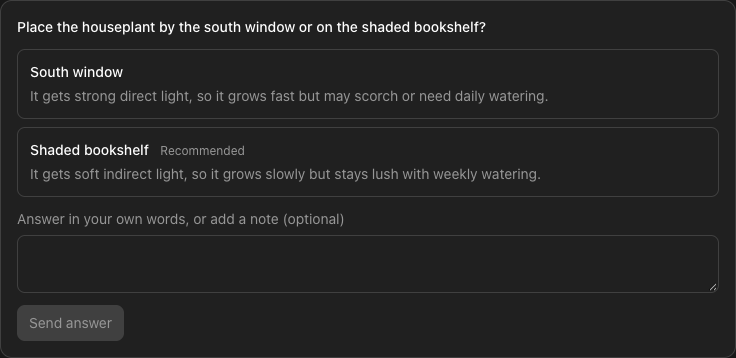
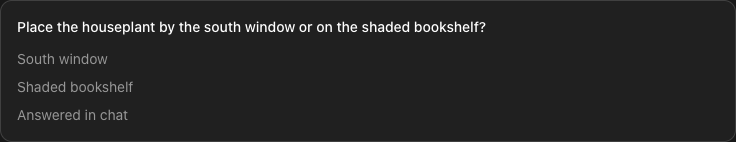
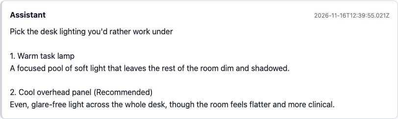
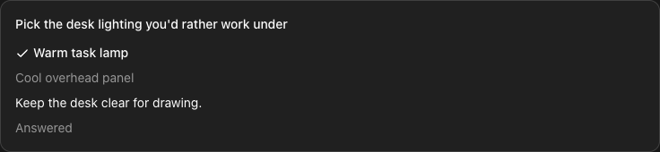
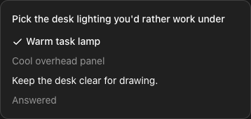

# Complete decision exchanges — 2026-11-16

AI-generated by Amp on Engel Nyst's behalf for [Canvas fork PR #137](https://github.com/enyst/OpenHands/pull/137), addressing [the follow-up review](https://github.com/enyst/OpenHands/pull/137#pullrequestreview-5919967715).

Canvas source: [955cd7bccc7bfdb675cc142cd99d77890e4427d4](https://github.com/enyst/OpenHands/commit/955cd7bccc7bfdb675cc142cd99d77890e4427d4).
SDK/client: [d107550769da1cdd9ed549b72ea1003468d1e63c](https://github.com/OpenHands/software-agent-sdk/commit/d107550769da1cdd9ed549b72ea1003468d1e63c), unchanged in this round.
The live build used these Canvas source changes before committing them; its build-input fingerprint was `2ed568558dfebfff-dirty`. No further source edits followed live verification.

## Fixed

- Successful asks export as assistant entries containing the actual question, both options, consequences and recommendation, even with tool details disabled. Answers remain user entries; generated duplicate messages stay hidden.
- Ordinary submission failures disappear when a later chat reply or answer settles the card. The saved-but-not-running HTTP 429 warning remains visible and does not offer to resend.
- Closing events are indexed once per history-array change, separately for main/planner scopes. Memoized cards receive stable action/closing-event references instead of each scanning and copying the remaining history. This removes the per-card scans; no browser frame-rate benchmark is claimed.
- The planner regression now first proves an ordinary card is actionable with the feature enabled, then verifies the planner card is read-only. A multi-question regression also checks that the first question remains superseded and a planner reply does not close the main agent's pending question.

## Observed checks

- Before fixing production code, the complete-exchange export cases and stale-alert case failed: **3 failed / 20 passed**. They passed after the fixes.
- Related Canvas tests: **73 files / 950 tests passed**, plus the export modal's **1 file / 9 tests passed**; **74 files / 959 tests** in total. These are focused suites, not a full-suite result.
- Canvas lint/typecheck, changed-file ESLint, app build, library build, formatting and translation completeness passed using the locally built SDK client. Full lint retained 133 existing warnings, no errors.
- The isolated real-stack doctor passed with matching source fingerprints. The real browser was restored online; after reload there were zero app/page errors. Expected offline connection failures and a few selector/preview setup mistakes were kept separate from product checks.

## Live reproduction and results

Build and pack the SDK client locally and install it without saving a manifest/lockfile change. Launch a new isolated headed `control-openhands` stack using that SDK checkout, run doctor, configure the saved DeepSeek Flash connection privately, and enable Settings > Experimental > Decision cards. No user stack was restarted.

1. Ask the agent to invent a houseplant-placement question with two options, consequences and the second recommended, without separate narration. Limit tools to `ask_user` before the answer and acknowledgement/finish afterwards. The model chose South window / Shaded bookshelf.
2. Enter a radiator note, put the real browser context offline and select South window. The request fails, the note remains, and the failure alert appears. Restore the network and answer in ordinary chat. The card changes to “Answered in chat” with **no stale failure alert**.
3. Start a separate desk-lighting conversation using the same constraints, without supplying the actual question or labels in the user prompt. The model asks “Pick the desk lighting you'd rather work under”, offering Warm task lamp / Cool overhead panel, recommending the second. Select the first and add “Keep the desk clear for drawing.” The agent acknowledges; reload retains the first-option checkmark and note, also at phone width.
4. Use the real export modal to download Markdown and HTML with tool details both enabled and disabled. All four configurations contain the exact generated question, both consequences and the recommendation, the exact note once and no generated answer header. Inspect the downloaded HTML in the browser: the assistant question entry is readable and complete. The raw conversation exports are deliberately not published here.

## Inspected captures

## Delivery and limits

This round changes only the Canvas fork branch `feat/canvas-decision-cards`. There is still no standalone upstream Canvas decision-card branch/PR; creating one needs Engel's decision. SDK changes from the previous round are already mirrored to upstream PR #6852.

The draft remains blocked on release of the compatible SDK/TypeScript client, followed by the exact npm pin/lockfile and minimum-server update. Clean-install fork CI currently installs the older published client and fails on its missing ask/reactions/experimental APIs. No compatibility shim, dependency-pin bypass, package release, merge or deployment was added. Cloud, ACP-native asks and answering planner/delegated cards remain unverified or unsupported as previously recorded.
