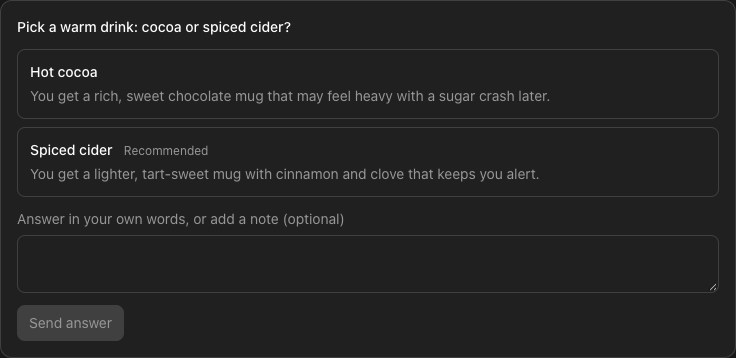
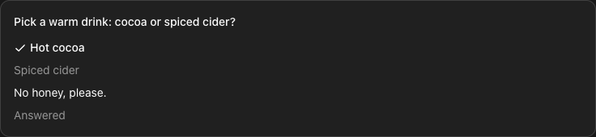
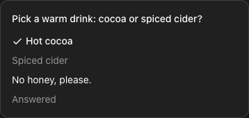

# SDK recovery parity — 2026-11-16

AI-generated by Amp on Engel Nyst's behalf for [Canvas fork PR #137](https://github.com/enyst/OpenHands/pull/137).

Current Canvas source: [97bd75619b849dec645ab13b6737a8980e3043ca](https://github.com/enyst/OpenHands/commit/97bd75619b849dec645ab13b6737a8980e3043ca).
Current SDK/client: [e2da143e7f3d970e84a4871bb3890921c41d8d11](https://github.com/OpenHands/software-agent-sdk/commit/e2da143e7f3d970e84a4871bb3890921c41d8d11).

The earlier [complete-exchange fixes and export verification](../followup-20261116/README.md) remain valid for their recorded source. This addendum records the subsequent SDK branch advancement and matching Canvas recovery change.

## Concurrent upstream changes preserved

Immediately before finishing, comparison found the upstream SDK branch two commits ahead of the fork, with no divergence. Both commits were read and fast-forwarded, rather than overwritten: one-question-per-response handling, read-only ask confirmation bypass, goal-loop stopping on a pending question, and answer-delivery recovery. The original commits, including the client payload exports from this thread, remain in history. The fork mirror was pushed only after fetching/comparing both branches and passing the focused SDK checks. No new upstream SDK commit was created by this round.

The recovery rule is now explicit: an `AskUserAnswerEvent` alone does not close the SDK's pending question; the user's delivery message must be saved too. A process dying between those writes leaves the question retryable. Canvas previously settled on the event alone and would strand that question after reload.

## Canvas change and automated evidence

- The new public-rendering regression reproduced that mismatch before the fix: **1 failed / 9 passed**. After the fix, a history containing only an orphaned answer remains actionable; a later delivered retry selects the new answer, not the old orphan.
- The shared history index recognizes delivery before using an answer event as the closing event. A successful endpoint response still settles the current card immediately because the endpoint has confirmed delivery. The HTTP 429 saved-but-not-running behavior is retained.
- **74 focused Canvas files / 960 tests passed**, plus lint/typecheck, app/library builds and formatting, using the local client. Lint has the same 133 existing warnings, no errors.
- **69 focused SDK tests passed**, covering `tests/tools/ask_user`, `tests/sdk/conversation/goal` and `tests/agent_server/test_goal_loop.py` on the newly mirrored source.
- The crash-gap scenario was checked through SDK tests and the Canvas hydration regression. No claim is made that a live server was deterministically killed between the two event writes.

## Live combined-stack verification

A fresh isolated headed `control-openhands` run built the exact committed Canvas source against the updated SDK checkout. Doctor passed with no warnings and matching clean source fingerprints. The locally built client remained installed without manifest/lockfile changes.

Using the saved DeepSeek Flash connection privately, enable Decision cards and Confirmation Mode in Settings, then start a conversation asking for one generated warm-drink decision, two consequences and the second option recommended. Allow no other tools before the answer, and only acknowledgement/finish afterwards. The model asked Cocoa / Spiced cider; the card appeared without an additional approval step. Select the first option with “No honey, please.” Reload: the Cocoa checkmark, note and Answered status remain, including at phone width. Revisit Settings > Verification to confirm Confirmation Mode was saved as checked. Browser app/page errors were zero.

## Remaining gates

Canvas remains a **fork-only draft**, blocked on a compatible published SDK/TypeScript client and the subsequent npm pin/lockfile and minimum-server update. The prior fork CI run on the complete-exchange commit failed because published 1.62.0 lacks the required typed APIs; its description/artifact checks passed. The recovery commit has its own CI subscription. There is no standalone upstream Canvas PR yet, and creating one needs Engel's decision. Cloud, ACP-native asks and answering planner/delegated cards remain outside the live-verified scope. No release, merge, deployment or user-stack restart occurred.
