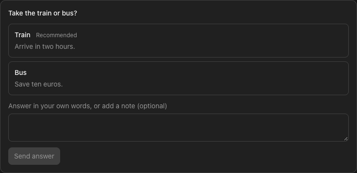
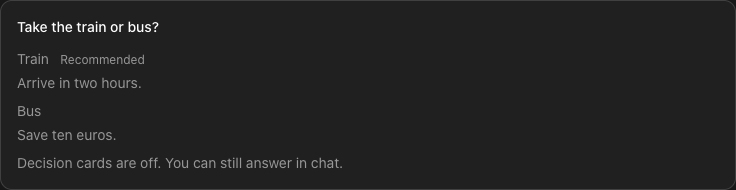
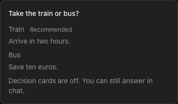
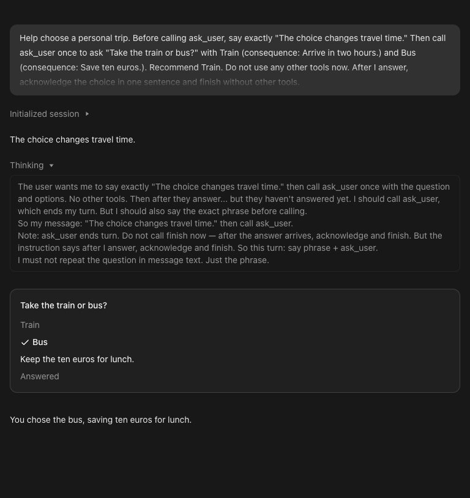

# Decision-card review follow-up — 2026-11-16

AI-generated by Amp on Engel Nyst's behalf for [Canvas fork PR #137](https://github.com/enyst/OpenHands/pull/137).

Tested Canvas: [`678ef6c520e689b1c4b74edf43867a176bc0f69f`](https://github.com/enyst/OpenHands/commit/678ef6c520e689b1c4b74edf43867a176bc0f69f).
Tested SDK/client: [`d107550769da1cdd9ed549b72ea1003468d1e63c`](https://github.com/OpenHands/software-agent-sdk/commit/d107550769da1cdd9ed549b72ea1003468d1e63c),
now mirrored to both forks and upstream SDK PR #6852 without overwriting commits.

## Fixed and verified

- Export decision answers as user entries in Markdown and HTML while hiding the
  duplicate generated chat message. Option-plus-note and text-only regressions
  failed before the fix and pass now.
- Pending read-only cards retain consequences and the recommendation. Desktop
  and phone captures below were inspected for readable content and overflow.
- Preserve the action's narration and reasoning when its result becomes a
  standalone card. A regression with nonempty thought/reasoning failed before
  the fix; the real-model run retained both after reload.
- Expose an accessible label on the selected option's checkmark. After reload,
  the live accessibility tree reported `img "Answered"`; read-only DOM inspection
  identified its containing option as `Bus`.
- Export `AskUserAction` and `AskUserObservation` from the TypeScript client,
  mirroring the Python producer. Canvas imports them rather than maintaining
  local wire declarations. Name the experimental feature identifier consistently
  with the existing reactions implementation.

## Live reproduction

Build/pack the tested client and install it locally without saving a manifest or
lockfile change. Launch an isolated stack from the tested Canvas checkout with
`control-openhands launch --new --sdk-path "$SDK_CHECKOUT" --build always`.
Doctor passed with a matching build fingerprint. Configure a real DeepSeek Flash
profile privately and enable Settings > Experimental > Decision cards.

Ask the agent to say "The choice changes travel time." and call `ask_user` with
Train (Arrive in two hours.) and Bus (Save ten euros.), recommending Train.
Allow only `ask_user` before the answer and an acknowledgment/finish afterwards.
Turn the feature off, return to the pending card, and inspect desktop and phone
layouts: both consequences and the recommendation remain. Turn it on, enter
"Keep the ten euros for lunch.", choose Bus, and reload. Narration, reasoning,
the selected answer and note remain; no machine answer bubble appears.

Export Markdown without tool details and export HTML. Both actual downloads
contained the note exactly once, included Bus, and omitted the machine answer
header. Browser page/app error counts were zero; final doctor passed.

## Automated checks and limits

- Canvas related tests: **74 files / 954 tests passed**.
- Canvas lint/typecheck, app build, library build and translation completeness
  passed with the locally built client. Lint had 133 existing warnings.
- TypeScript client: **28 files / 438 tests passed**; build and changed-file
  ESLint/Prettier checks passed. Whole-client lint still reports three errors in
  unchanged integration-test files (unused `waitFor`, unused/reassignable
  `connectionCount`); those unrelated files were not edited.
- The full Canvas suite was not rerun; the earlier full-suite failures recorded
  in the parent evidence note remain outside these focused checks.
- Fork CI still cannot use the unreleased APIs from the committed published
  client pin. Release a compatible SDK/client, update the npm pin and lockfile
  and minimum Agent Server version, then rerun clean-install CI. The draft PR's
  description check passes. No release, merge or deployment was performed.
- This run verified local OpenHands. Cloud, ACP-native questions and answering
  delegated/planning-agent cards remain outside the verified scope.

## Inspected running-app captures

