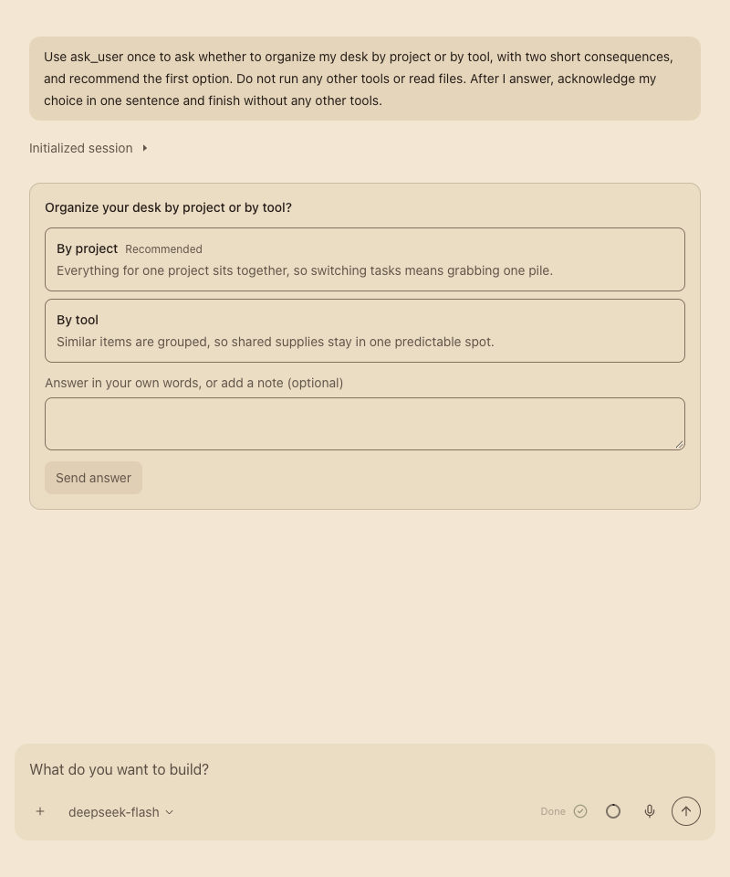
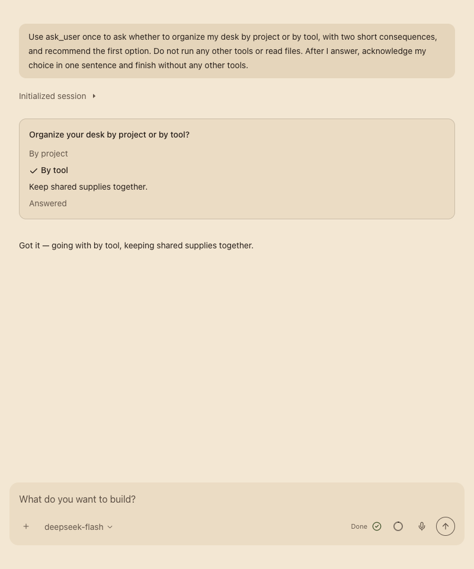
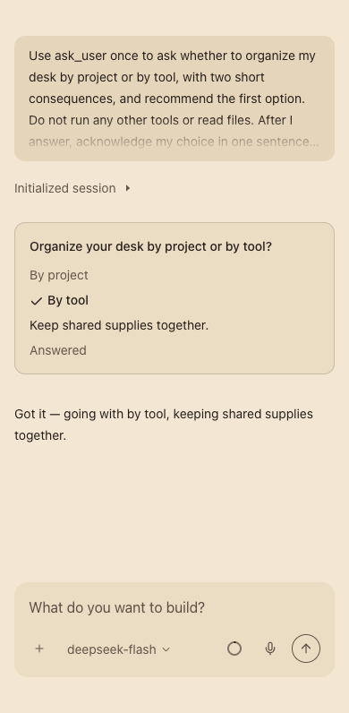
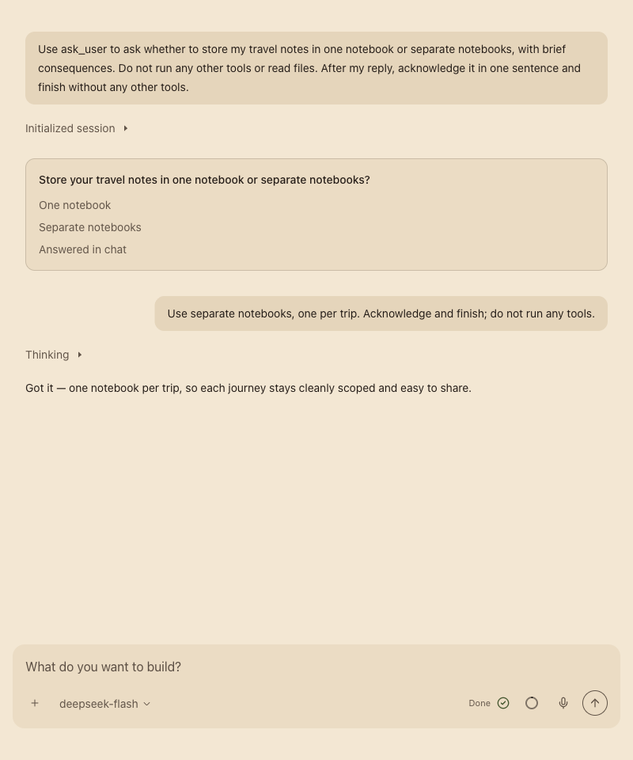

# Upstream review-fix verification — 2026-11-16

AI-generated by Amp on Engel Nyst's behalf for
[Canvas upstream PR #19789](https://github.com/OpenHands/OpenHands/pull/19789)
and [fork PR #137](https://github.com/enyst/OpenHands/pull/137).

Tested Canvas source:
[`edd1a9675df271757db933393a949ddf4cea4a77`](https://github.com/OpenHands/OpenHands/commit/edd1a9675df271757db933393a949ddf4cea4a77).
SDK/server and locally packed TypeScript client source:
[`e2da143e7f3d970e84a4871bb3890921c41d8d11`](https://github.com/OpenHands/software-agent-sdk/commit/e2da143e7f3d970e84a4871bb3890921c41d8d11).
The published dependency pin and lockfile were not changed. This is combined-source
verification, not proof of clean-install compatibility with published packages.

## Three review findings

- [Orphan answer followed by ordinary chat](https://github.com/OpenHands/OpenHands/pull/19789#discussion_r4588371774):
  the public card-rendering regression passes. An ordinary reply closes the card
  as answered in chat and does not select the abandoned option or show its note.
- [Shared-viewer submissions](https://github.com/OpenHands/OpenHands/pull/19789#discussion_r4588371785):
  the read-only card regression passes with no buttons or note input. Source
  inspection confirms the shared route passes `readOnly` through `Messages` to
  `DecisionCard`. This is not a live authenticated Cloud shared-view test.
- [Orphan answers in exports](https://github.com/OpenHands/OpenHands/pull/19789#discussion_r4588371798):
  the Markdown/HTML crash-and-retry regression passes. Both formats omit the
  abandoned answer note and include the delivered retry. Card hydration and
  exports use the same delivery-aware closure index.

## Executed checks

```sh
npm test -- __tests__/components/conversation-events/chat __tests__/components/features/chat src/utils/transcript-export/index.test.ts __tests__/routes/shared-conversation.test.tsx
npm run lint
node scripts/check-translation-completeness.cjs
CONTROL_OPENHANDS_HEADED=1 control-openhands launch --new --run-id decision-cards-upstream-review-20261116 --sdk-path "$SDK_CHECKOUT" --build always
control-openhands doctor
```

- **71 test files / 796 tests passed**; [captured output](tests.log).
  The named shared-conversation test path did not collect a separate route suite;
  read-only behavior is covered in the decision-card suite.
- Typecheck, ESLint and formatting passed; lint retained 133 existing warnings,
  zero errors. Translation completeness passed. The real stack's app build passed.
- The first direct Vitest invocation used stale ignored i18n declarations and
  failed the new waiting-label assertion. Regenerating with `npm run make-i18n`
  fixed the setup; `npm test` includes that generation and the complete rerun
  passed. No production code or assertion was changed to get this result.
- Final doctor passed with no warnings, matching clean source/build fingerprints;
  browser app errors and page errors were both zero.

## Live Paper-theme controls

The isolated headed stack used a real DeepSeek Flash profile. Existing user
stacks were not restarted. Paper was selected through Settings > Application;
Decision cards was enabled through Settings > Experimental before the valid run.

1. Ask for a desk-organization choice (by project/by tool), two consequences and
   the first recommended. Permit only `ask_user`, then acknowledgment/finish after
   answering; prohibit other tools and file reads.
2. Enter `Keep shared supplies together.` and choose the non-recommended By tool.
   The model acknowledges. Reload: the selected option, exact note and Answered
   status remain, with no generated answer bubble. Inspect desktop and phone.
3. Download Markdown without tool details and HTML through the real export modal.
   Both downloads contain the question, both options and consequences, the exact
   note once, and no `[Answer to your question` machine header. Raw conversation
   exports are not published.
4. Start a separate notebook-choice question. Answer through ordinary chat:
   `Use separate notebooks, one per trip.` The card remains Answered in chat
   after reload, without a falsely selected option, and the model acknowledges.

Initial setup attempts hit the hidden switch input rather than its label and
therefore did not enable the feature; two conversations without the tool were
excluded from the valid card run. A theme Save click was unnecessary because
theme selection applies immediately. A menu snapshot used the wrong ARIA role.
These setup/selector mistakes are not counted as product failures or successes.

## Inspected captures






## Delivery and limits

The exact tested fix commit was fast-forwarded to the fork's
`feat/canvas-decision-cards` branch after fetching and comparing both remotes.
Upstream advanced meanwhile to
[`c0df3cd164a7cd408f9d60b76852cccf3deab2c3`](https://github.com/OpenHands/OpenHands/commit/c0df3cd164a7cd408f9d60b76852cccf3deab2c3),
which merges the prerequisite branch. That merge is preserved upstream; this
round mirrors only the specifically approved fix commit and does not claim to
verify the merged base. The relevant closure/card/export code is unchanged by
that merge; the shared route retains `readOnly`.

The crash window itself was exercised through the existing regressions, not by
killing a live server between event writes. No authenticated Cloud shared-view
check, full Canvas suite, new library build, release, merge, deployment or
upstream push was performed. Release/client-pin/minimum-server gates remain.
