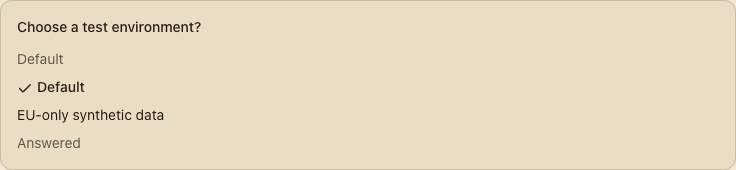

# Pending questions take precedence over completion

AI-generated verification record on Engel Nyst's behalf, 2026-11-16.

Fork PR: https://github.com/enyst/agent-sdk/pull/48

Current SDK head: [`4609a8edef439cc306fe073d61fb6fecfc350eb0`](https://github.com/enyst/agent-sdk/commit/4609a8edef439cc306fe073d61fb6fecfc350eb0), branch `fix/ask-user-pending-precedence`, based on [upstream main](https://github.com/OpenHands/software-agent-sdk/commit/14b7007ea). Product fixes, the broad suite, TypeScript checks and live Canvas evidence are from [`7725ea31973dd4f13d766841596f80b981600b7e`](https://github.com/enyst/agent-sdk/commit/7725ea31973dd4f13d766841596f80b981600b7e). The second commit changes only the hook commands in the two new test cases for portability; the focused suite and HTTP workflow were rerun on it. The fork's main already matched upstream at the final comparison. No upstream push was made.

## Before → after, and compatibility decisions

- **Stop hooks:** successful `ask_user` sets FINISHED. Previously completion Stop-hook denial then called the model again without an answer. Both `run()` and `arun()` now stop before completion hooks while an ask is pending. After a genuine answer, ordinary completion still invokes the hook and honors denial. No automatic hook answer is generated.
- **Refinement:** a batch containing both `ask_user` and `finish` previously continued through iterative refinement and generated user feedback, closing the question. A successful turn-ending tool now takes precedence over completion refinement.
- **Goal loops:** resuming an interrupted goal previously sent `RESUME_PROMPT` as an unmarked user message, consuming an unanswered ask. Goal start/resume now refuses pending asks with `pending_ask` (HTTP 400). Goal-generated messages carry `sender="goal"`; SDK `run_goal()` returns the current `GoalAsked` rather than overwriting it. Card answers and ordinary chat both allow subsequent resume.
- **Option identity:** two options may legitimately share a label but have different consequences. The LLM now receives `Option 1: Default` or `Option 2: Default`, not just `Default`. Blank labels are rejected during tool execution, allowing model correction without tightening deserialization of old action events. No serialized field, action schema, or feature default changed.
- **Client comment:** TypeScript now accurately says that the delivered genuine user message closes pending state, not the answer event alone. The existing orphan-answer/retry regression exercises this contract. A comment-only correction does not warrant a manufactured source-text regression test.

Primary code: [agent finalization](https://github.com/enyst/agent-sdk/blob/7725ea31973dd4f13d766841596f80b981600b7e/openhands-sdk/openhands/sdk/agent/agent.py), [local run loops](https://github.com/enyst/agent-sdk/blob/7725ea31973dd4f13d766841596f80b981600b7e/openhands-sdk/openhands/sdk/conversation/impl/local_conversation.py), [server goal orchestration](https://github.com/enyst/agent-sdk/blob/7725ea31973dd4f13d766841596f80b981600b7e/openhands-agent-server/openhands/agent_server/event_service.py), [answer text](https://github.com/enyst/agent-sdk/blob/7725ea31973dd4f13d766841596f80b981600b7e/openhands-sdk/openhands/sdk/event/ask_user.py), [tool execution](https://github.com/enyst/agent-sdk/blob/7725ea31973dd4f13d766841596f80b981600b7e/openhands-tools/openhands/tools/ask_user/definition.py).

## Regression evidence

- On [merged SDK](https://github.com/OpenHands/software-agent-sdk/commit/329fe5e2f7d52ddb3576c27b8543f050f7446fc4), eight regressions failed: sync/async Stop hooks, sync/async mixed finish/refinement, duplicate-label identity, SDK goal restart while pending, and server goal resume after either card or chat answers. See [failure list](before-regressions-summary.log), [assertion excerpts](before-regression-failures.log), and [unanswered resume accepted](before-goal-resume-failures.log).
- Before the blank-label fix, the whitespace-label case made one model request instead of returning an error and continuing for correction: [failure excerpt](before-blank-label-failure.log).
- **Current head: 232 passed**, covering ask_user, SDK goal runner/controller/judge, iterative refinement, server goal loops and EventService: [portable-hook rerun](portable-regressions-service.log), [original product-head run](final-regressions-service.log).
- A real localhost Agent Server, HTTP requests, WebSocket events and RemoteConversation exercise the goal/ask/Stop-hook lifecycle. Only the LLM is scripted. The workflow failed on the merged baseline and passes on the current head: [before](before-live-http-summary.log), [portable-hook rerun](portable-live-http.log), [original after](final-live-http.log). It checks: ask leaves pending; Stop-hook marker absent; resume returns 400; a real answer allows resume; completion succeeds and the hook marker exists.
- **Broader run: 2265 passed, 1 failed, 6 deselected**: [summary](isolated-broad-summary.log). The sole failure is the untouched FIFO timeout test, which measured 244 ms against a 200 ms wall-clock upper limit: [failure](isolated-broad-failure.log). The same test also fails on the unchanged merged SDK at 246 ms: [baseline](baseline-fifo.log). This is not a wholly green broad suite; no assertion was weakened or skipped.
- **TypeScript: 438 tests pass**, build passes: [tests](final-client-tests.log), [build](final-client-build.log). Full-client ESLint reports three errors in two unchanged integration-test files: [log](final-client-lint.log). Both files match the base byte-for-byte. The edited `events/types.ts` passes ESLint. Changed-file pre-commit checks, including Pyright, pass: [log](final-precommit.log).

The initial broad attempt used the developer's HOME and accidentally loaded personal profiles/skills; that run is invalid as clean-room validation and is not published. Its seven normal-message call-shape failures were caused by an unnecessary extra argument in the initial patch, which was removed before the final head. All final EventService tests pass unchanged. A small isolated-home control on the baseline passed the affected personal-settings cases. The blank-label excerpt excludes captured personal prompt text.

The first fork [Windows run](https://github.com/enyst/agent-sdk/actions/runs/43930249452/job/133520425933) found two failures in the new Stop-hook tests: their POSIX shell command did not execute in Windows `cmd.exe`, so the completion-control assertion failed. The test-only follow-up uses the existing `tests.command_utils.python_command` helper in both unit and live-server cases. Local reruns above pass; the new head's Windows CI is still pending, not claimed green. The product behavior is unchanged by that test correction.

## Canvas compatibility — real LLM, Paper theme

Unchanged Canvas [`edd1a9675df271757db933393a949ddf4cea4a77`](https://github.com/enyst/OpenHands/commit/edd1a9675df271757db933393a949ddf4cea4a77), using its locally built SDK TypeScript client, connected to the final SDK worktree. The isolated stack was restarted after the final sender-call correction. No release dependency pins were changed; this does not verify the published 1.62.0 client.

1. Set **Paper** before testing, enable Decision cards, configure DeepSeek Flash through the saved test connection.
2. Ask for two `Default` options, first meaning production and second staging, recommending the first. This is explicitly a synthetic UI test with no file changes or deployment.
3. Add `EU-only synthetic data`, click the second option, and wait for the real agent.
4. Observe the generated message contains `Option 2: Default`; the agent identifies **staging** and repeats the note: [targeted event observations](sdk-followup-final-delivery.json).
5. Reload: the second row remains checked, the note and Answered status persist: [ARIA snapshot](sdk-followup-final-card.json). The raw generated answer header remains hidden.
6. No page/app errors after the restarted stack settled and the final reload: [error check](sdk-followup-final-clean-errors.json). The deliberate backend restart did produce expected transient connection-refused/WebSocket errors during downtime; those are not claimed absent.



No Canvas code change is required by these SDK fixes. The card already submits and selects by `option_index`; closure matching uses the unchanged answer prefix and excludes messages with a sender; errored AskUser observations are not pending questions. Existing card/export suites pass **30 tests**: [log](canvas-tests.log). Goal-resume rejection is also covered at the real HTTP boundary; no browser goal-loop claim is made here.

## Reproduction commands

Run from the SDK worktree with its existing environment and an isolated HOME:

```sh
mkdir -p .amp/in/test-home
HOME="$PWD/.amp/in/test-home" uv run --no-sync pytest tests/tools/ask_user tests/sdk/conversation/goal tests/sdk/agent/test_iterative_refinement.py tests/agent_server/test_goal_loop.py tests/agent_server/test_event_service.py
HOME="$PWD/.amp/in/test-home" uv run --no-sync pytest tests/cross/test_remote_conversation_live_server.py -k pending_question
HOME="$PWD/.amp/in/test-home" uv run --no-sync pytest tests/tools/ask_user tests/sdk/agent tests/sdk/conversation tests/agent_server/test_goal_loop.py tests/agent_server/test_event_service.py
git diff 14b7007ea --name-only | xargs uv run pre-commit run --files
```

From `clients/typescript`, run `npm run build`, `npm test`, `npm run lint`, and `npx eslint src/events/types.ts`. From Canvas, run `npm test -- __tests__/components/conversation-events/chat/decision-card.test.tsx src/utils/transcript-export/index.test.ts`.

For the live UI, use the repository's `control-openhands launch --new --sdk-path <SDK_CHECKOUT>`, export the returned `OH_VERIFY_RUN`, use Paper, and follow the five steps above. Use the normal credential input mechanism; never print or put credentials in the command line. The two-regime backend regressions are committed in the SDK test files, not in this evidence repository.

## Limits and delivery gate

This is local source-stack and regression evidence on macOS arm64, not deployed or packaged-image evidence. No live crash killing, production mutation, cross-platform run, or benchmark score is claimed. CI and integration tests run on the fork and are followed by subscriptions; draft code review was skipped by CodeRabbit. The HUMAN section remains the repository template placeholder for a human to fill. Upstream delivery needs enyst's explicit approval after reviewing the fork results. Hook auto-answering remains deferred.
