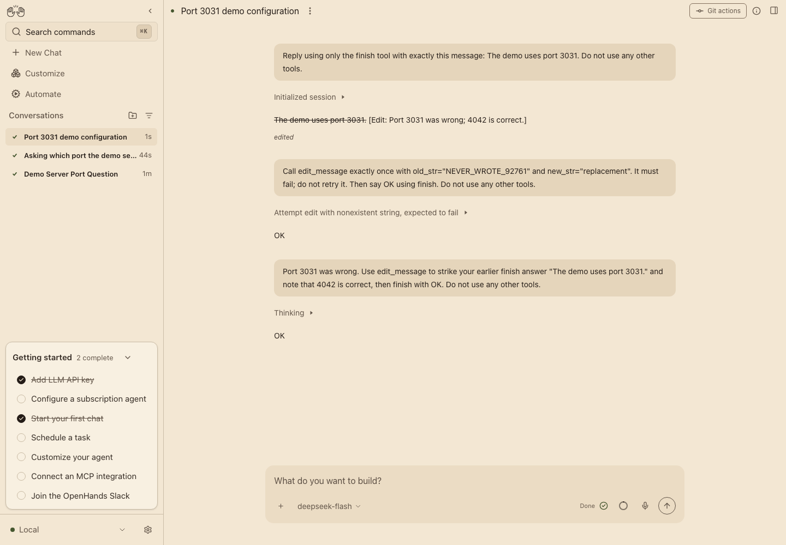
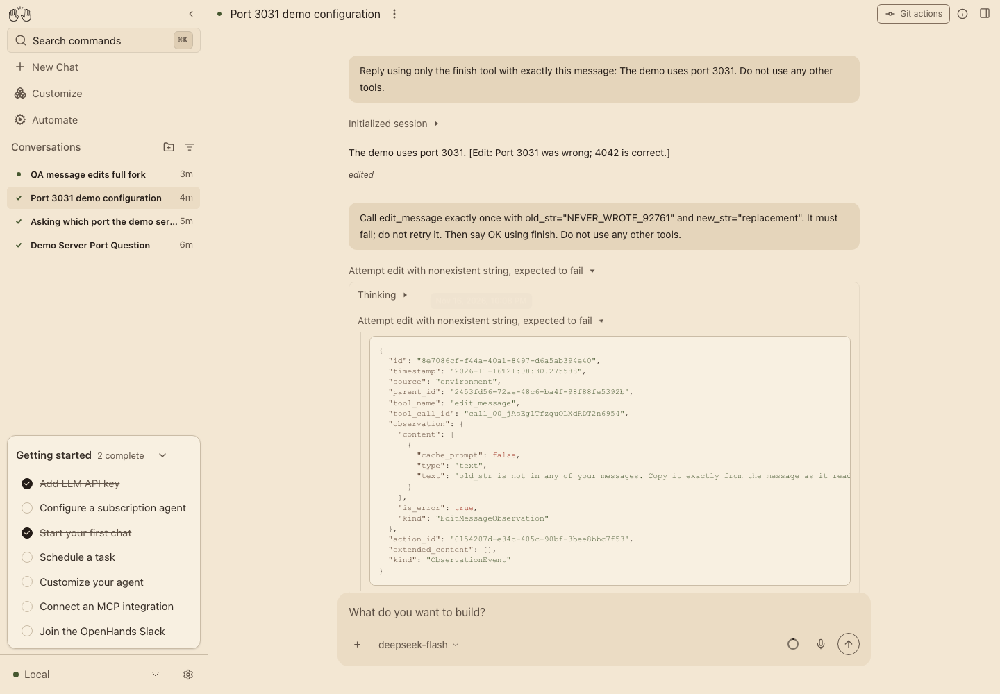
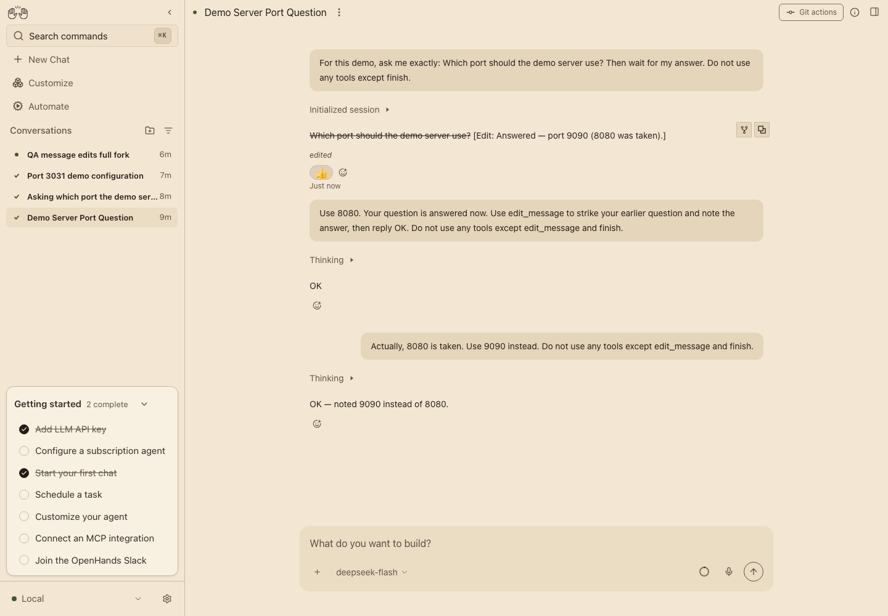
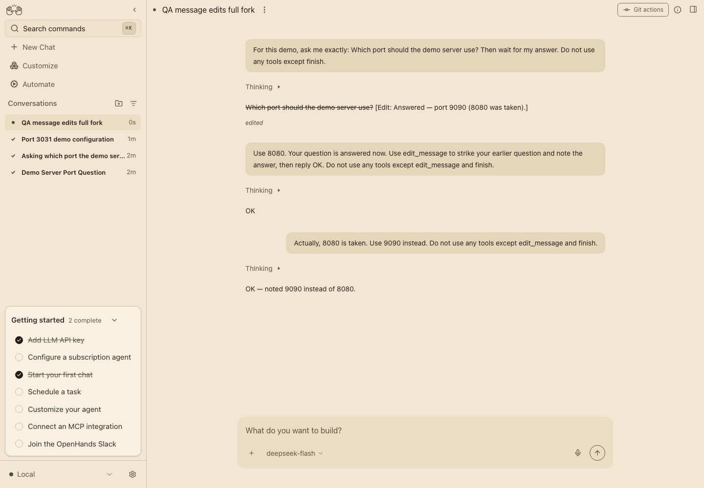
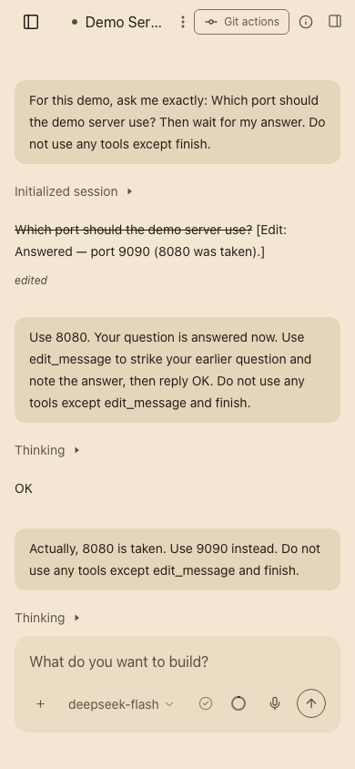

# Message edits: SDK #6876 / Canvas #19794

Review and isolated live verification, 2026-11-16. AI-generated by Amp on
Engel Nyst's behalf. Every Canvas capture uses **Paper**.

## Verdict

**Not ready for unconditional approval.** One reproducible SDK correctness bug
is fixed on the fork. The default-off requirement passes for newly created
OpenHands conversations, but not as a global kill switch: old opted-in
conversations retain their edit tool and Canvas still folds their edits after
the flag is turned off. This is deliberate in the PR, not an accidental missing
conditional. Engel must decide whether creation-time opt-in meets the requirement.

Canvas also remains dependent on its experimental-settings base PR and a release
containing the new TypeScript client. No upstream changes were pushed, no upstream
review was submitted, and no package release or deployment was triggered.

## Exact revisions and fork delivery

| Item | Revision |
| --- | --- |
| [SDK PR #6876](https://github.com/OpenHands/software-agent-sdk/pull/6876), exact mirror `enyst/agent-sdk:review/message-edits-6876` | [`ab1ad103537f834eca838ab642c404a299b59f37`](https://github.com/enyst/agent-sdk/commit/ab1ad103537f834eca838ab642c404a299b59f37) |
| SDK pagination fix, `enyst/agent-sdk:fix/message-edits-pagination-6876` | [`2fbc7c080d77eac70c97f448cfff1fb9217cb4b3`](https://github.com/enyst/agent-sdk/commit/2fbc7c080d77eac70c97f448cfff1fb9217cb4b3) |
| [Canvas PR #19794](https://github.com/OpenHands/OpenHands/pull/19794), exact mirror `enyst/OpenHands:review/message-edits-19794` | [`ce62e404ab917ff98db8fd27aefdea449f6a7c07`](https://github.com/enyst/OpenHands/commit/ce62e404ab917ff98db8fd27aefdea449f6a7c07) |
| SDK upstream and fork `main` when checked | [`922e1ec6ab1f79839f737364ede95f8f2287a6fe`](https://github.com/enyst/agent-sdk/commit/922e1ec6ab1f79839f737364ede95f8f2287a6fe) |
| Canvas upstream and fork `main` when checked | [`7d5eae0c49dcbd8c9137d5ed542f44335ae3c1c1`](https://github.com/enyst/OpenHands/commit/7d5eae0c49dcbd8c9137d5ed542f44335ae3c1c1) |

Both PR descriptions explicitly link the other PR. Canvas is stacked on
[#19503](https://github.com/OpenHands/OpenHands/pull/19503), not main. SDK's
experimental-flags precedent is merged #6759. The exact mirror branches remain
unchanged; the fix is a separate fork branch. Canvas has no additional code changes.

## Review findings

### Fixed: conversation reader silently loses corrections after 100 edits

`ReadConversationExecutor` fetched only the newest 100 `MessageEditEvent`s. A
correction to question A disappeared from the transcript when message B had 101
later revisions, even though A was among the returned messages. The stored edit
was intact; only the reader's folding was wrong.

The fix follows `next_page_id`, retaining the first/newest edit for each target.
The timestamp lower bound excludes edits older than the oldest candidate message.
It extends the existing public-tool regression test, rather than adding tests of
private implementation details. The test failed on the original reader and passed
with the fix.

The same real server conversation, created using a **scripted provider, not a
real model**, demonstrated the discrepancy:

```text
Original reader: [agent] Question A?
Fixed reader:    [agent, edited] ~~Question A?~~ [Edit: Answer A.]
Both readers:   [agent, edited] Port revision 101.
```

See [pagination-repro.py](pagination-repro.py) for a reusable real-server fixture.
Run it with the selected SDK worktree's Python and `CONTROL_AGENT_SERVER` pointing
to that worktree's `control-agent-server`; export the isolated
`AGENT_SERVER_VERIFY_RUN`. Run both readers against the same generated conversation
to compare. The regression unit test independently reproduces the failure.

### Decision needed: creation-time flag versus strict disable

`message_edits` defaults false in the existing experimental-feature registry.
`experimental_feature_tools()` injects the tool only when enabled. The server's
existing pattern chooses tools at conversation creation; it does not strip tools
from persisted agents after settings change. Explicit SDK tool configuration is
also not a server feature-flag enforcement boundary.

Canvas's `useMessageEdit()` and successful-tool-card suppression do not consult
the flag. The PR explicitly explains that hiding historical edits would restore
text the agent had corrected. Browser verification after switching the flag off
still found one edited mark and the latest correction. New off conversations
had no tool and no edited mark. Thus **default-off opt-in passes; a strict
"off means no folding, marks, or suppression anywhere" contract does not**.

Changing this would reverse the stated design and needs a human decision, not an
unrequested kill-switch implementation.

### Existing accepted limitation: condensation

The SDK PR explicitly accepts a narrow case in which a retained head message
loses its edit observation to condensation and a subsequent edit starts from the
original text. It also documents the one-event `navigate_to` gap. The review did
not silently redesign this tradeoff or claim it is solved.

### Release and rollout dependency

Published SDK/client versions are still 1.62.0. All feature-capable Canvas builds
used the locally built client from the SDK PR, copied into installed dependency
output without modifying package pins or lockfiles. This is **source testing**,
not proof that the currently published client can build this UI.

A separate stack using the actually published Agent Server 1.62.0 showed the
Experimental page's graceful empty state. Its frontend still used the local
client. No full published-package pairing or clean released-client build passed
here; release, pin bump and fresh CI are required before merge.

## Executed checks and controls

| Check | Result and scope |
| --- | --- |
| SDK tool/remote-conversation/agent/experimental-router suites | **1,255 passed**, 6 deselected by normal test selection, on the fixed source. Isolated HOME prevents unrelated user plugins entering tests. Initial run using real HOME failed from those plugins; not hidden as product failures. |
| Additional SDK event-focused selection | **192 passed** on original PR source. |
| Pagination regression | Red on original reader, green on fixed reader; real-server same-data before/after also confirmed. |
| Per-file hooks and commit hooks | Ruff format/lint, pycodestyle, pyright and repository gates passed for the two changed Python files. |
| TypeScript client | Build passed; **439 tests / 28 files passed** on PR source. |
| Canvas feature/reaction/grouping/rendering tests | **99 tests / 5 files passed**, using local client. |
| Canvas typecheck, production build, translations | Passed; translations complete in all locales. |
| SDK F39 live map, two fresh runs | Four recipe bullets / five feature IDs passed each time, no blocked cases. Real DeepSeek question/edit/immutable-original path; deterministic provider recorder for exact model-history contents and missing-string control. |
| Flag off, real browser + DeepSeek | New conversation has no edit tool and no badge despite explicitly requesting an edit. Original question stays unchanged. |
| Flag on, real browser + DeepSeek | Question folded to 8080, then to 9090 after the user said 8080 was unavailable, without explicitly requesting that second edit. Original stored message unchanged; append-only edit events present. |
| Latest edit/reload | One badge and latest text after reload; API event inspection verifies original text is unchanged. The model briefly duplicated a question during an intermediate edit, then corrected it; this is not a guarantee of model formatting reliability. |
| Finish answer | Real model edited an earlier `finish` answer from 3031 to 4042; Canvas displayed the updated answer and badge. |
| Missing-string failure | Real model called the tool with an absent string; error observation stayed visible in an expandable tool card and produced no successful edit event. |
| Reactions | Browser picker added thumbs-up to edited question; real REST event's `target_text_ending` contained the corrected 9090 text, not the original question. |
| Fork and restart | Full API fork retained edits; restarting this isolated stack retained the fork's correction and persisted experimental setting; doctor passed. Fork creation itself was API-driven, not claimed as a UI fork workflow. |
| Phone | 390 × 844 Paper rendering of latest edit inspected; no overlapping badge/text. |
| Existing conversation after flag disabled | Correction and one badge remain. Confirms creation-time semantics, not strict gating. |
| Browser diagnostics | No page errors/app errors in captured browser diagnostics. |
| Published backend control | Agent Server 1.62.0 healthy; Experimental empty state rendered. No real-model feature support claimed there. |
| Fork CI | Both exact mirrors and the pagination-fix head reported **No CI checks found**. This is not a pass. No workflow was manually triggered. |

Selected process output is retained in [checks.txt](checks.txt). This contains
test/build summaries only, not raw runtime state or conversation exports.

SDK broad selection:

```sh
HOME=<isolated-test-home> uv run pytest \
  tests/tools/message_edit tests/tools/conversation_mentions tests/tools/reaction \
  tests/sdk/conversation/remote tests/sdk/agent \
  tests/agent_server/test_experimental_features_router.py
```

Canvas selection:

```sh
npx vitest run \
  __tests__/components/features/chat/message-edits.test.tsx \
  __tests__/components/conversation-events/chat/group-events.test.ts \
  __tests__/components/conversation-events/chat/event-content-helpers/should-render-event.test.ts \
  __tests__/components/features/chat/user-assistant-event-message.test.tsx \
  __tests__/components/features/chat/message-reactions.test.tsx
npm run typecheck
npm run build
```

## Inspected evidence

Screenshots illustrate the visible result. Runtime/API checks described above,
not screenshots alone, establish tool availability, persistence and immutability.

| State | Capture |
| --- | --- |
| Default off |  |
| Off conversation |  |
| Latest edit after reload |  |
| Existing opted-in conversation after disabling |  |
| Edited finish answer |  |
| Failed tool expanded |  |
| Reaction on edited question |  |
| Fork after restart |  |
| Phone |  |
| Released-backend control |  |

[Live-edit video](media/live-edit.mp4): original question → 8080 → 9090. The
reload transition is too fast to establish persistence from this video alone;
separate post-reload DOM/API checks do so.

[Failure and finish-answer video](media/failure-and-finish.mp4).

## Not proved / next actions

- No Cloud/device-link deployment tested; all feature-capable live checks used
  isolated local source servers and real DeepSeek. Cloud sign-in was not completed.
- No Docker runtime, published binary, real ACP model, delegation/planning-mode
  matrix, or large-history Canvas pagination/performance live test. Targeted unit
  tests are not substitutes for those production paths.
- No live reproduction of the accepted condensation/navigation window, and no
  empirical claim that unprompted editing is reliable across models or runs.
- No exhaustive before/after equivalence proof for every unrelated flag-off
  feature, and no full repository/browser suite. Relevant controls and suites
  above pass; that is narrower than "nothing else can break."
- Fork push alone starts no Canvas branch CI. An approved draft fork PR, fork
  issue reference and Engel's own HUMAN note are needed to exercise that workflow.
- Engel: decide creation-time opt-in versus strict disable. After that decision
  and remaining validation/release prerequisites, explicitly approve any upstream
  push; fetch and compare both sides again before delivering the fix upstream.

No private conversation exports, credential files or raw runtime directories are
published here. The original shared working trees and protected stacks were not
used for testing.
